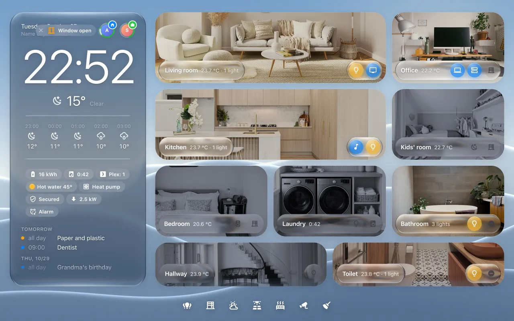
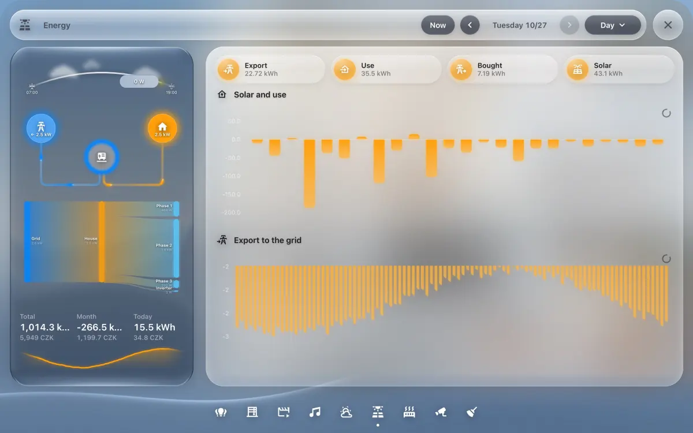
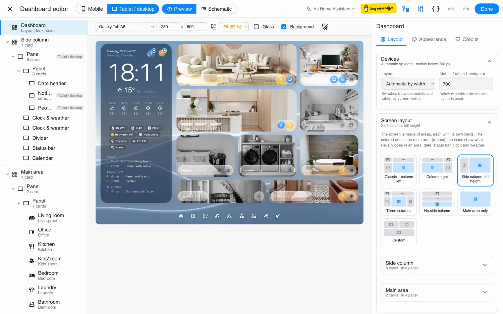

# Glass Cards

**Liquid glass dashboards for Home Assistant – built visually in Glass Studio.**

[](https://github.com/hacs/integration)
[](https://github.com/martinargalas/glass-cards/releases)
[](https://www.home-assistant.io)
[](LICENSE)

<a href="https://buymeacoffee.com/argii" target="_blank"></a>

**[Website and live demo](https://glass.argalas.org) · [Documentation](docs/README.md)**



| Pop-ups over the dashboard | Glass Studio |
| --- | --- |
|  |  |

Glass Cards is a set of 27 cards and a full-screen dashboard for Home Assistant, in a liquid
glass look: panels that really refract the wallpaper, soft tiles, a dark sidebar like the Home
app – or, for older tablets, the same look at almost no cost.

- **Not a theme.** No card_mod, no CSS hacks: every material, colour and font is a setting.
- **Glass Studio** – a full-screen editor with a live preview on real device sizes (iPhone, iPad,
  Galaxy Tab, Nest Hub…), drag and drop, pop-ups, undo and safe saving.
- **One dashboard for every screen** – it rearranges itself for phones, tablets and computers.
- **Day and night** – its own wallpaper and look after sunset, per card if you want.
- **Fast on wall tablets** – only panels blur; five looks from *liquid* to *solid*.
- **A demo home inside** – one click adds a dashboard of a made-up home to try everything on,
  without touching your devices.

## The cards

| Overview | Rooms | Climate and energy | Building blocks |
| --- | --- | --- | --- |
| [Date header](docs/cards/date-header.md) | [Room](docs/cards/room-card.md) | [Heat pump](docs/cards/heat-pump.md) | [Dashboard](docs/cards/dashboard.md) |
| [Clock and weather](docs/cards/clock-weather.md) | [Lights](docs/cards/light.md) | [Air quality](docs/cards/air-quality.md) | [Panel](docs/cards/panel.md) |
| [Status bar](docs/cards/status-bar.md) | [Thermostat](docs/cards/thermostat.md) | [Radar](docs/cards/radar.md) | [Tabs](docs/cards/tabs.md) |
| [People](docs/cards/people.md) | [Blind](docs/cards/blind.md) | [Period bar](docs/cards/period-bar.md) | [Dock](docs/cards/dock.md) |
| [Calendar](docs/cards/calendar.md) | [Appliance](docs/cards/appliance.md) | [Chart](docs/cards/chart.md) | [Pop-up header](docs/cards/popup-header.md) |
| [Running now](docs/cards/now.md) | [Room map](docs/cards/room-map.md) | [Automation switch](docs/cards/automation.md) | [Divider](docs/cards/divider.md) |
| [Notifications](docs/cards/notifications.md) | | [Sun and shading](docs/cards/sun-shading.md) | |
| | | [Value grid](docs/cards/value-grid.md) | |

## Install

**HACS:** HACS → ⋮ → *Custom repositories* → `https://github.com/martinargalas/glass-cards`, type
*Dashboard* → search **Glass Cards** → *Download* → reload the browser.

**By hand:** copy `dist/glass-cards.js` and `dist/wallpapers/` to `config/www/glass-cards/` and add
the resource `/local/glass-cards/glass-cards.js` (JavaScript module).

Details: [Install](docs/install.md).

## Quick start

1. Open any Home Assistant page with `?glass-studio` at the end of the address.
2. Click **Demo dashboard** – the author's own dashboard, pop-ups and all, on a made-up home, appears in the sidebar.
3. Look around, then [build your own](docs/first-dashboard.md).

```yaml
type: custom:glass-dashboard
preset: sidebar
look: liquid
wallpaper: glass:hills-day
left:
  - type: custom:glass-panel
    cards:
      - type: custom:glass-clock-weather
        weather: weather.home
main:
  - type: custom:glass-panel
    layout: grid
    columns: 3
    cards:
      - type: custom:glass-room-card
        name: Living room
        icon: mdi:sofa
        entities:
          - entity: light.living_room
```

## Optional companions

- [Bubble Card](https://github.com/Clooos/Bubble-Card) – for pop-up windows (or use pages without it).
- [apexcharts-card](https://github.com/RomRider/apexcharts-card) – for the Chart card.

## Development

```bash
npm install
npm run build        # dist/glass-cards.js + dist/wallpapers
npm run web          # the live demo on http://localhost:5174 (no Home Assistant needed;
                     # Bubble Card and the demo's other HACS cards go in web/vendor/)
npm run build:web    # the live demo for the web site → dist-web/
```

The demo home lives in `src/demo` and `examples/demo.yaml`; `scripts/docs-options.mjs` fills
the option tables in `docs/cards` from the cards' code.

## Credits and licence

Built on other people's work – see [CREDITS.md](CREDITS.md). Wallpapers are generated for this
project. MIT licence.

An independent project, not affiliated with or endorsed by Home Assistant or the Open Home
Foundation.
