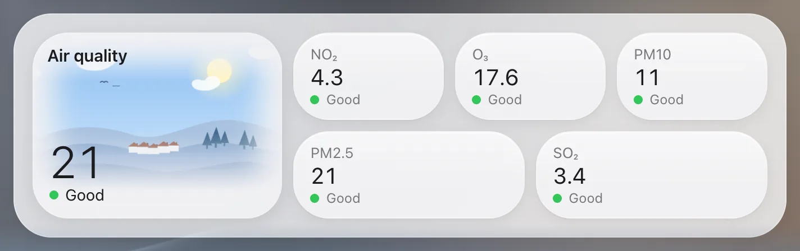

# Air quality

`custom:glass-air-quality`

The air quality index as a big tile with a picture of the level – clear sky and birds, haze, smog and chimneys – that stays grey while the air is fine, and a small tile for every pollutant on the same scale.



**Good for:** a weather or climate page.

## Quick start

```yaml
type: custom:glass-air-quality
entity: sensor.air_quality_index
pollutants:                       # optional – default: the other sensors of the same device
  - sensor.air_quality_pm2_5
  - sensor.air_quality_pm10
  - entity: sensor.air_quality_ozone
    name: Ozone
```

Values are read on the US EPA AQI scale (0–500), which the WAQI integration and most others report. Your own limits for a sensor in µg/m³: `limits: [15, 25, 37.5, 50, 75]` (WHO / EU steps for PM2.5).

## Tips

- `images: [...]` – your own six pictures, one per level; `image: …` – one for all.
- `image_color: always` – always in colour.

## Options

<!-- options -->
| Option | Type | What it does |
| --- | --- | --- |
| `entity` **required** | string | Entity |
| `pollutants` | (Pollutant \| string)[] |  |
| `name` | string | Name |
| `images` | string[] | Pictures of the index tile per level (good … hazardous); default: from a run in the woods to smoking chimneys. |
| `image` | string | One picture for every level instead. |
| `title` | string | Title |
| `image_fade` | boolean | Picture fading into the tile |
| `name_backdrop` | boolean | Band under the name |
| `edge_fade` | boolean | the picture's soft edge on the top, left and right (default true) |
| `level_style` | "dot" \| "tile" \| "none" |  |
| `level_colors` | string[] |  |
| `limits` | Limits | Own levels for the index (see Limits). |

#### Look

Materials and colours of the card's parts – set them in the card's **Appearance** tab, or here.

| Option | Type | What it does |
| --- | --- | --- |
| `image_color` | "active" \| "always" \| "never" | active (default): grey while the air is good / moderate, in colour from "unhealthy for sensitive groups" on; always; never. |
| `hero_glass` | material | Material of the main tile – see [Materials](../appearance.md#materials). |
| `hero_color` | string | Colour of the main tile (a tint of its material). |
| `tiles_glass` | material | Material of the tiles – see [Materials](../appearance.md#materials). |
| `tiles_color` | string | Colour of the tiles (a tint of its material). |
<!-- /options -->

---

[All cards](../README.md#the-cards) · [Look and feel](../appearance.md) · [Actions and conditions](../actions-and-conditions.md)
