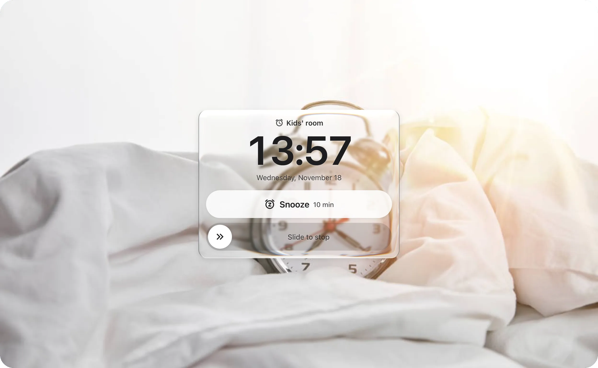
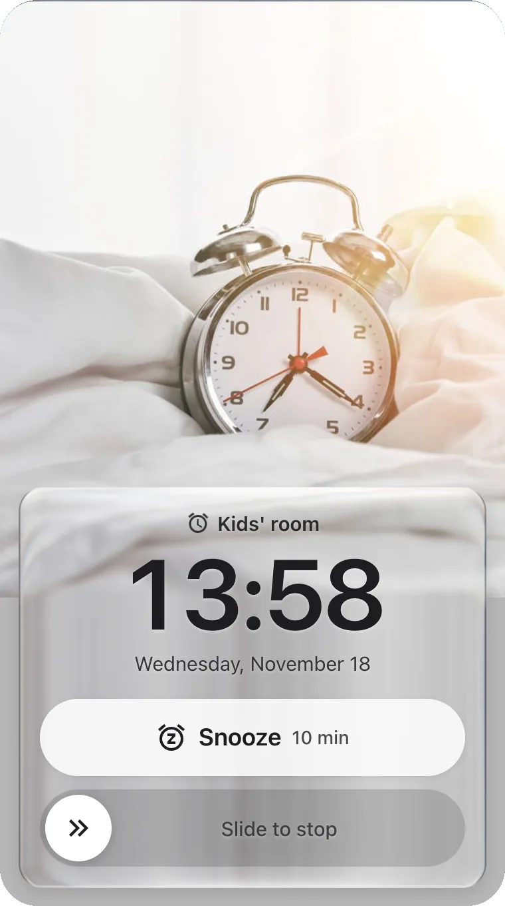
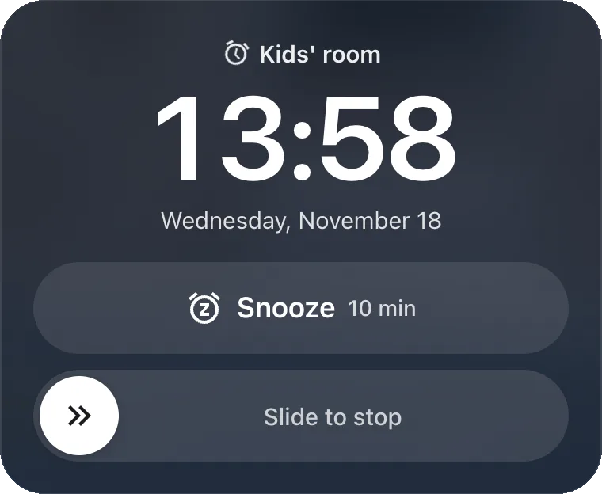

# Alarm ringing

`custom:glass-alarm-ring`

What you see when an alarm of the [Alarms](alarms.md) card rings: the time, the alarm's name, **Snooze** and a slider that stops it. By default it shows over the dashboard on a morning photo under liquid glass. Until an alarm rings the card is invisible.



## What you need

1. **A speaker**: any media player that plays an address, such as Google Cast, Sonos or AirPlay.
2. **An alarm in the [Alarms](alarms.md) card.** It sets up everything the alarm needs to ring: its helpers and its automation. You need to be an administrator to create an alarm.
3. **This card, once, on the dashboard**: in the Dashboard Studio (or *Add card* in Home Assistant) pick **Glass – alarm ringing**. It needs no settings.

The alarm rings even with no dashboard open, because its automation plays the sound. This card only shows **Snooze** and **Stop** on screens that have the dashboard open.

## When it rings



- **Snooze**: tap it, or swipe the alarm up. The sound stops and the alarm rings again in 10 minutes (see `snooze`). It counts whole minutes, so it can ring up to a minute later.
- **Slide to stop**: drag the knob to the right. A slider can't be pressed by accident, the way a button half asleep can. With a keyboard: focus it and press → or Enter.

Either one stops the sound on every speaker of the alarm and closes the alarm on every screen. If nobody touches it, the alarm stops by itself after the automation's **Stop after** time (*Settings → Automations & scenes → Glass alarm 1…*).

## Show as

| | |
| --- | --- |
| **Modal over the dashboard** (default) | Over everything, with the dashboard dimmed behind it. Needs nothing else. |
| **Bubble Card pop-up** | Opens a [Bubble Card](https://github.com/Clooos/Bubble-Card) pop-up of yours, with the alarm inside. Needs two cards, see below. |
| **In this card** | The alarm right where the card is: the one inside the pop-up. |

In the Dashboard Studio and in Home Assistant's card editor, an invisible card shows a dashed box that says how it will show. Its **Try it** button shows a sample alarm. A sample's Snooze and Stop only close it: no alarm changes.

### In a Bubble Card pop-up

Two cards: one opens the pop-up when an alarm rings, the other one inside the pop-up shows the alarm.

```yaml
# the dashboard's overlay (or any section): opens #alarm-ring when an alarm rings
- type: custom:glass-alarm-ring
  display: popup
  popup: "#alarm-ring"

# the pop-up, with the alarm in it
- type: vertical-stack
  cards:
    - type: custom:bubble-card
      card_type: pop-up
      hash: "#alarm-ring"
      is_sidebar_hidden: true
      width_desktop: 100%
      margin_top_desktop: 0
      styles: |
        .bubble-pop-up-container::after { display: none !important; }
        .bubble-pop-up-container { --ring-space: 40px; }
    - type: custom:glass-alarm-ring
      display: card
```

- On a [glass dashboard](dashboard.md), put both into its **overlay**. A pop-up in the main area moves aside with the side column.
- `styles` removes the empty strip Bubble Card leaves under a pop-up's cards, and `--ring-space` sets how much of the screen's height the photo leaves free.
- On a tablet the pop-up is as wide as the photo can be, while the whole photo still fits the screen's height. The alarm sits in its middle.

## Look

| `style` | |
| --- | --- |
| `photo` (default) | A morning photo under a light liquid glass panel that shows the photo through it. On a tablet you see the whole photo; on a phone it fills the screen. |
| `simple` | The time and the buttons on the card's glass (default `dark-liquid`), with no photo. |



A photo of your own: `image: /local/morning.jpg` (a file in `config/www/`). A landscape photo with free space in its middle works best: the glass panel sits there. Set `--ring-photo-ratio` (e.g. `16 / 9`) when its shape isn't 3 : 2.

The glass panel over the photo is WebGL liquid glass (`panel_glass: liquid-gl`). **Snooze** and the slider are plain. Give them a material with `controls_glass`, and set every text's colour, font and size in the Studio's **Appearance** tab.

## Troubleshooting

**The alarm rang but no screen showed it.** Check that the dashboard is open and that the card is on it. In edit mode it shows the dashed box, which means it's there. An alarm created before this card existed gets what it needs the first time an administrator opens a dashboard with the Alarms card or this one.

**Snooze rang a little late.** Snooze rings at the start of a minute, so up to 59 seconds after 10 minutes.

## Options

<!-- options -->
| Option | Type | What it does |
| --- | --- | --- |
| `display` | "modal" \| "popup" \| "card" | how it shows: modal (default) – over the dashboard; popup – opens a Bubble Card pop-up (`popup`); card – in the card itself (the one inside the pop-up) |
| `popup` | string | display: popup – the pop-up's hash (default #alarm) |
| `style` | "simple" \| "photo" | photo (default): a morning photo under liquid glass; simple: the time and the buttons on the card's glass |
| `image` | string | style photo – a photo of your own (default the cards' morning photo) |
| `snooze` | number | Snooze: minutes until it rings again (default 10) |
| `preview` | boolean | display: card – a sample alarm while nothing rings, to see its look |

#### Look

Materials and colours of the card's parts – set them in the card's **Appearance** tab, or here.

| Option | Type | What it does |
| --- | --- | --- |
| `glass` | GlassMode | style simple – the card's glass (default dark-liquid) |
| `panel_glass` | material | style photo – the glass panel over the photo (default liquid-gl, WebGL liquid glass) |
| `panel_color` | string | Colour of the panel (a tint of its material). |
| `controls_glass` | material | Snooze and the slider: their material (default plain) |
| `controls_color` | string | Colour of the controls (a tint of its material). |
<!-- /options -->

---

[All cards](../README.md#the-cards) · [Alarms](alarms.md) · [Look and feel](../appearance.md)
