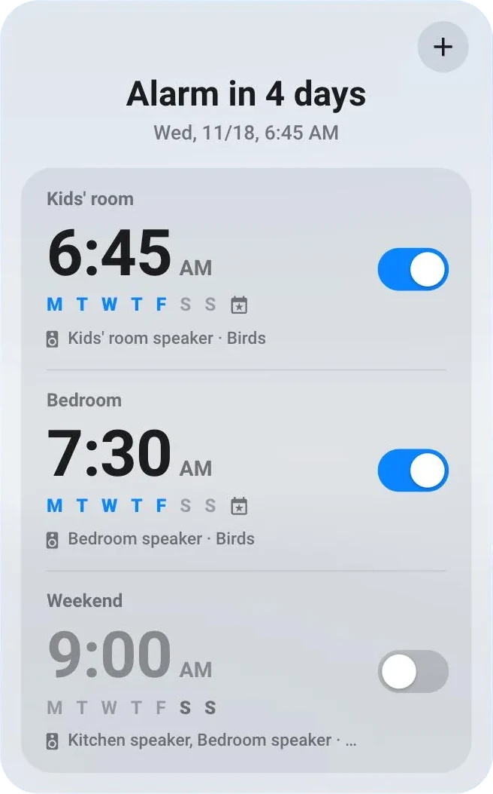
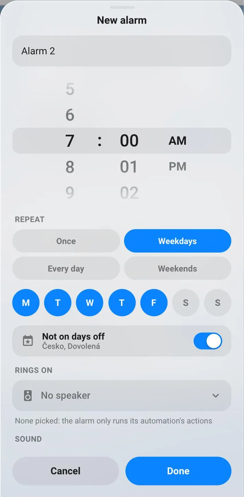
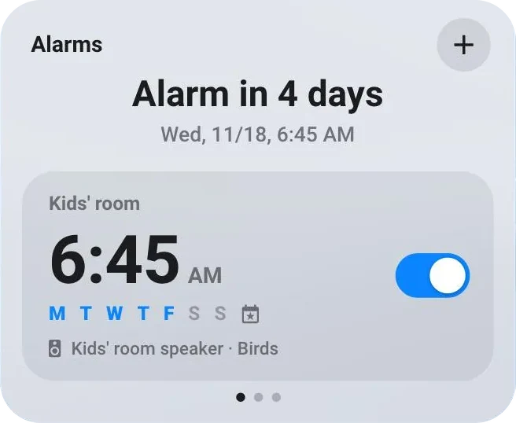
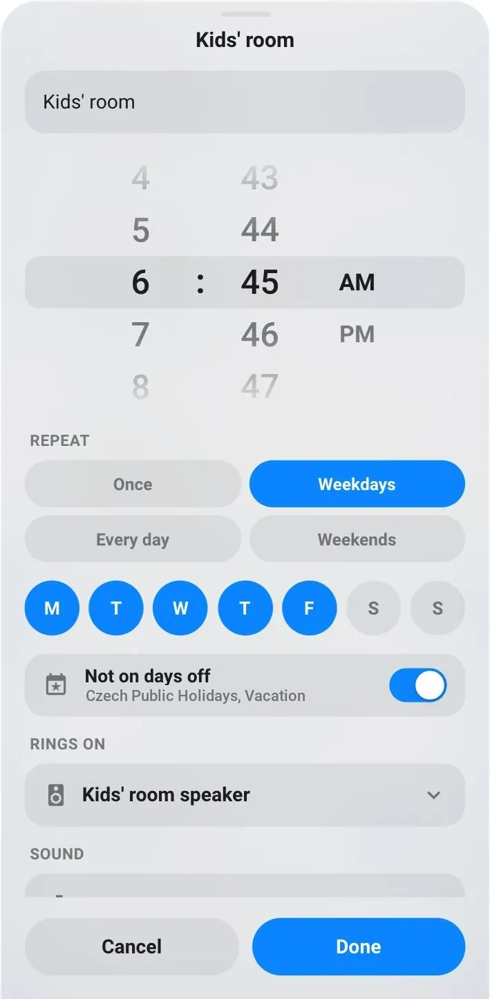
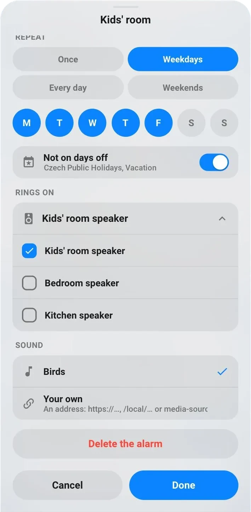

# Alarms

`custom:glass-alarms`

Your alarm clocks in one card, the way a phone's clock app shows them. On top, when the next alarm rings; under it every alarm with its time, the days it rings on, the speaker it plays on and a switch. A tap on an alarm changes it, **+** adds a new one – no helpers or automations to set up by hand.



**Good for:** a family's mornings – the kids' room on weekdays, the bedroom a bit later, a lie-in at the weekend – each ringing on its own speaker, not on public holidays.

## Get started in a minute

1. **Add the card.** In the Dashboard Studio (or Home Assistant's *Add card*), pick **Glass – alarms**. It needs no settings to start.
2. **Tap +** in the card's top right corner. A new alarm opens.
3. **Set it up** – the name, the time, the days, where it rings – and tap **Done**.

That's it: the alarm is in the card and will ring at its time.



> **+ is there for administrators only** – adding an alarm creates things in Home Assistant (see [What the card creates](#what-the-card-creates)). Everyone else can still switch the alarms on and off and change them.

## Your alarms in the card

- **On top** – when the next alarm rings: *Alarm in 4 days*, *Alarm in 8 h 15 min*, and its day and time. With every alarm off it says so.
- **Each alarm** – its name and time; the days of the week, the ones it rings on in colour (an alarm that rings once shows its date instead); the speaker and the sound. A small calendar icon means it skips a day off on the way.
- **The switch** – turns that alarm on or off. Off, the alarm turns grey and keeps its settings.

Short of room? `layout: carousel` shows one alarm at a time – swipe to the others, the dots show where you are.



## Changing an alarm

Tap an alarm. On a phone its settings slide up from the bottom; on a tablet they open in the middle. Nothing is saved until you tap **Done** – **Cancel** (or a tap outside) leaves it as it was.



- **Name** – shown above the time.
- **Time** – scroll or tap the wheels (the arrow keys work too). In English with AM / PM, in Czech and German 24 hours – or as your Home Assistant profile sets the time format.
- **Repeat** – *Once*, *Weekdays*, *Every day*, *Weekends*, or any days of your own: tap them one by one. The week starts on Monday in Europe.
  An alarm set to ring **once** rings the next time the clock gets there, then switches itself off.
- **Not on days off** – the alarm skips public holidays and your days off (see [Days off](#days-off)). Turn it off for an alarm that should ring anyway.
- **Rings on** – open the list and tick the speakers it plays on; several at once work too. With none ticked the alarm plays nothing – it only runs the actions of its automation (see [More than a sound](#more-than-a-sound)).
- **Sound** – *Birds*, a calm melody that comes with the cards, or **Your own**: the address of any sound or stream – `https://…/wake-up.mp3`, a file of yours in `config/www/sounds/` as `/local/sounds/wake-up.mp3`, or `media-source://…`.
- **Delete the alarm** – tap it twice: the second tap deletes the alarm and everything the card created for it.



## Days off

Alarms that skip days off don't ring on them – the card counts with that too, so *Alarm in…* always tells the truth.

A day off is an **all-day event** in a calendar you pick in the card's settings (Studio → the card → **Days off**):

- **Public holidays** – add Home Assistant's **Holiday** integration for your country (*Settings → Devices & services → Add integration → Holiday*). It brings a calendar of your public holidays.
- **Your own days off** – any calendar works: a local one, Google, CalDAV… Put your holidays in it, or a day off called *No alarm*.

Events with a time – a meeting at 6:00 – never count.

```yaml
type: custom:glass-alarms
skip_calendars:
  - calendar.czechia      # public holidays (the Holiday integration)
  - calendar.holidays     # your own
```

## More than a sound

Each alarm has its automation in Home Assistant, **Glass alarm 1**, **Glass alarm 2**… (*Settings → Automations & scenes*). Open it to add what should happen when it rings – open the blinds, turn on the lights, start the coffee – under **Actions**, or set how loud it gets (**Volume**, **Getting louder**) and when it stops (**Stop after**).

## Speakers and sounds to choose from

By default **Rings on** lists every media player. To offer only some – and your own sounds beside *Birds* – set them in YAML:

```yaml
type: custom:glass-alarms
players:
  - media_player.kids_room
  - media_player.bedroom
sounds:
  - { name: Radio, url: https://ice.example.com/stream.mp3 }
  - { name: Rooster, url: /local/sounds/rooster.mp3 }
```

A speaker plays the sound from your Home Assistant, so it has to reach it: with a sound from `/local/…` (Birds too), check that Home Assistant's *local network* address is set in *Settings → System → Network*.

## Look

In the Studio's **Appearance** tab every part has its material and colour: the alarms' group, the days they ring on, the switches, the **+** button – and the settings window (the same materials as a card's background, the real liquid glass too) with its controls.

## What the card creates

For each alarm, when you tap **Done** on a new one:

- **Helpers** (*Settings → Devices & services → Helpers*), named *Glass alarm 1 …*: the time, on / off, the days, the name, the speakers, the sound and *days off* on / off. They hold the alarm; the card only shows and changes them.
- **An automation**, *Glass alarm 1*, that rings it – made from the **Glass alarm** blueprint, which the card saves into Home Assistant by itself (no import needed).

**Delete the alarm** removes both again. Don't rename these helpers – the card finds its alarms by their names.

Prefer helpers of your own, or one alarm on its own tile? See the [Alarm](alarm.md) card.

## Questions

**The alarm didn't ring.** Check that the alarm's switch is on, that today is one of its days and not a day off, and that a speaker is ticked. Then open its automation (*Glass alarm …*) → **Traces**: it shows whether it ran and where it stopped.

**There's no + in the card.** It shows for Home Assistant administrators only.

**It rang and nothing played.** The speaker couldn't fetch the sound – see the note on the network address under [Speakers and sounds to choose from](#speakers-and-sounds-to-choose-from), or try a sound with an `https://` address.

## Options

<!-- options -->
| Option | Type | What it does |
| --- | --- | --- |
| `title` | string | Title – Empty = none, only + |
| `skip_calendars` | string[] | days off: calendars whose all-day events the alarms skip – public holidays (the Holiday integration), your holidays… |
| `players` | string[] | the speakers offered (default: every media player) |
| `sounds` | { name: string; url: string }[] | sounds offered beside the cards' own melody: { name, url } |
| `minute_step` | number | the wheels' minutes: every 1 (default), 5, 10, 15 or 30 |
| `layout` | "list" \| "carousel" | list: every alarm under each other (default); carousel: one at a time, the others a swipe away |
| `show_next` | boolean | when the soonest alarm rings, above the list – "Alarm in 3 days" (default shown) |

#### Look

Materials and colours of the card's parts – set them in the card's **Appearance** tab, or here.

| Option | Type | What it does |
| --- | --- | --- |
| `active_color` | string | an alarm on: its switch, the picked days, the buttons – default blue |
| `add_glass` | material | the + button: its material (default a faint tint) and a tint over it |
| `add_color` | string | Colour of the add (a tint of its material). |
| `list_glass` | material | the alarms' group (the carousel too): its material and a tint over it |
| `list_color` | string | Colour of the list (a tint of its material). |
| `switch_glass` | material | the switches: the track's material when off, and their colour when on (default active_color) |
| `switch_color` | string | Colour of the switch (a tint of its material). |
| `days_color` | string | the days an alarm rings on, lit (default active_color) |
| `sheet_glass` | GlassMode | the settings' window: its glass, as a card's background (liquid – the real liquid glass, dark-liquid, frosted, light, flat, solid, home, none; default its own dark or light glass) and a tint over it |
| `sheet_color` | string | Colour of the sheet (a tint of its material). |
| `controls_glass` | material | the modal's controls – quick choices, days, fields, lists: their material and a tint |
| `controls_color` | string | Colour of the controls (a tint of its material). |
<!-- /options -->

---

[All cards](../README.md#the-cards) · [Look and feel](../appearance.md) · [Actions and conditions](../actions-and-conditions.md)
