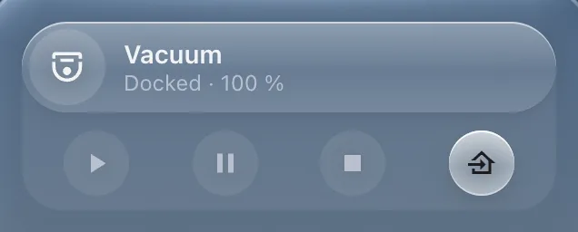

# Appliance

`custom:glass-appliance`

Machines that work on their own – a washing machine, a robot vacuum, a lawn mower – as a bar of liquid glass: the name, what it's doing, its progress or battery. Under it a drawer with its controls (start, pause, dock, nudge arrows) – or, for a washer, the stages of its cycle.



**Good for:** a devices page; one card per machine, a panel of them is the list.

## Quick start

```yaml
type: custom:glass-appliance
entity: vacuum.robot_vacuum
name: Robot vacuum
battery: sensor.robot_vacuum_battery
```

### A washing machine

```yaml
type: custom:glass-appliance
kind: washer
entity: sensor.washer_job_state
machine: sensor.washer_machine_state
remaining: sensor.washer_remaining_time
completion: sensor.washer_completion_time     # the bar fills with the cycle's progress
```

The states of SmartThings, LG ThinQ, Home Connect, Miele, Electrolux, Haier and Whirlpool are known. Anything else: its status sensor with `run_states` / `done_states`, a binary sensor, or a smart plug's power in W.

### A lawn mower

```yaml
type: custom:glass-appliance
entity: lawn_mower.garden_mower
progress: sensor.garden_mower_progress
battery: sensor.garden_mower_battery
nudge: { up: button.mower_forward, left: button.mower_left, right: button.mower_right, down: button.mower_back }
```

### Picking what shows beside it

With `select_group`, tapping the bar picks it – cards in the same panel can show for it (a robot's map next to the list):

```yaml
select_group: devices
select: vacuum
picked_first: true       # picked until another one is tapped
```


## Options

<!-- options -->
| Option | Type | What it does |
| --- | --- | --- |
| `select_group` | string | Group |
| `picked_first` | boolean | its `select` is the group's pick until one is tapped |
| `entity` **required** | string | Entity |
| `run_states` | string[] | washer: the states that mean each phase, for an integration whose states aren't known (see core/washer) |
| `pause_states` | string[] | Paused states |
| `done_states` | string[] | Done states |
| `run_above` | number | washer: a power sensor as `entity` – running above this many W (default 5) |
| `kind` | "vacuum" \| "mower" \| "washer" | default: from the entity's domain (vacuum, lawn_mower, else a washer) |
| `name` | string | Name |
| `icon` | string | Icon |
| `battery` | string | Battery (%) |
| `progress` | string | Progress (%) |
| `room_names` | map of string | vacuum: display names of the rooms in the progress' `current_room` |
| `charging` | string |  |
| `machine` | string |  |
| `remaining` | string |  |
| `power` | string | washer: its power (on until switched off; default `binary_sensor.<name>_power` next to `sensor.<name>_washer_machine_state`) |
| `completion` | string | washer: when the cycle ends (a timestamp; default the machine state's `…_completion_time`) |
| `stages` | Stage[] |  |
| `start` | action |  |
| `pause` | action |  |
| `resume` | action |  |
| `stop` | action | mower: end the job where it is (default `mammotion.cancel_job`) |
| `nudge` | { up?: string; left?: string; right?: string; down?: string } |  |
| `select` | string | Id |
| `hold_action` | action | Hold |

#### Look

Materials and colours of the card's parts – set them in the card's **Appearance** tab, or here.

| Option | Type | What it does |
| --- | --- | --- |
| `active_color` | string | Color when on |
| `bar_glass` | material | Material of the bar – see [Materials](../appearance.md#materials). |
| `bar_color` | string | Colour of the bar (a tint of its material). |
| `picked_glass` | material | Material of the picked one – see [Materials](../appearance.md#materials). |
| `picked_color` | string | Colour of the picked one (a tint of its material). |
| `fill_color` | string | Colour of the fill (a tint of its material). |
| `fill_style` | "fade" \| "solid" \| "glow" \| "none" |  |
| `fill_strength` | number | Fill strength (%) |
| `icon_glass` | material | Material of the icon – see [Materials](../appearance.md#materials). |
| `icon_on_glass` | material | Material of the icon while on – see [Materials](../appearance.md#materials). |
| `icon_background` | string |  |
| `tray_glass` | material | Material of the drawer under a bar – see [Materials](../appearance.md#materials). |
| `tray_color` | string | Colour of the drawer under a bar (a tint of its material). |
| `buttons_glass` | material | Material of the buttons – see [Materials](../appearance.md#materials). |
| `buttons_color` | string | Colour of the buttons (a tint of its material). |
| `current_glass` | material | Material of the current one – see [Materials](../appearance.md#materials). |
| `current_color` | string | Colour of the current one (a tint of its material). |
<!-- /options -->

---

[All cards](../README.md#the-cards) · [Look and feel](../appearance.md) · [Actions and conditions](../actions-and-conditions.md)
