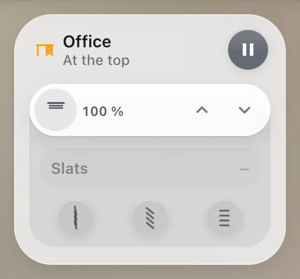

# Blind

`custom:glass-blind`

A room's blind: its position and its slats' tilt as two bars – tap anywhere on a bar or drag it – with quick choices under each, a stop button while it moves and the pause of the room's automation, its time left drawn as a ring.



**Good for:** blinds and shutters with tilting slats; any cover.

## Quick start

```yaml
type: custom:glass-blind
entity: cover.office_blind
name: Office
icon: mdi:desk
pause: switch.office_blind_pause    # optional: the automation's pause for this room
pause_duration: 3600                # s – for the ring
positions:                          # quick positions (default: up / down)
  - { name: Up, icon: mdi:arrow-up, value: 100 }
  - { name: Down, icon: mdi:arrow-down, value: 0 }
tilts:                              # quick tilts (default: closed / half / open)
  - { name: Min, value: 20 }
  - { name: Mid, value: 50 }
  - { name: Max, value: 80 }
```

A quick choice either sets a value (0–100) or runs a script: `{ name: Mid, script: script.office_tilt_mid }` – handy when your blinds need their own sequence.

## Tips

- `slats: bar` – the tilt bar without quick choices; `slats: none` – no tilt at all (rollers).
- With the [automation cards](../automation-cards.md) the blinds can follow the sun.

## Options

<!-- options -->
| Option | Type | What it does |
| --- | --- | --- |
| `entity` **required** | string | Entity |
| `name` | string | Name |
| `icon` | string | Icon |
| `pause` | string |  |
| `pause_duration` | number |  |
| `positions` | Choice[] |  |
| `tilts` | Choice[] |  |
| `slats` | "full" \| "bar" \| "none" | the slats in the drawer: their bar and quick tilts, the bar only, or no drawer |
| `hide_pause` | boolean | Hide the pause button |
| `show_icon` | boolean | the blind's button on the position bar (default shown) |

#### Look

Materials and colours of the card's parts – set them in the card's **Appearance** tab, or here.

| Option | Type | What it does |
| --- | --- | --- |
| `active_color` | string | the blind down (bar fill, icon); the pause ring – default orange |
| `pause_color` | string | Colour of the pause (a tint of its material). |
| `pause_glass` | material | the pause button: its material (default Apple Home's dark glass) and a tint over it |
| `pause_button_color` | string | Colour of the pause button (a tint of its material). |
| `positions_glass` | material | the quick choices: the positions on the bar (default none) and the tilts in the drawer (default dark) |
| `tilts_glass` | material | Material of the tilts – see [Materials](../appearance.md#materials). |
| `choices_color` | string | Colour of the choices (a tint of its material). |
| `bar_glass` | material | Material of the bar – see [Materials](../appearance.md#materials). |
| `bar_color` | string | Colour of the bar (a tint of its material). |
| `slats_glass` | material | Material of the slats bar – see [Materials](../appearance.md#materials). |
| `slats_color` | string | Colour of the slats bar (a tint of its material). |
| `tray_glass` | material | Material of the drawer under a bar – see [Materials](../appearance.md#materials). |
| `tray_color` | string | Colour of the drawer under a bar (a tint of its material). |
| `icon_glass` | material | Material of the icon – see [Materials](../appearance.md#materials). |
| `icon_on_glass` | material | Material of the icon while on – see [Materials](../appearance.md#materials). |
| `icon_background` | string |  |
| `fill_color` | string | Colour of the fill (a tint of its material). |
| `fill_style` | "fade" \| "solid" \| "glow" \| "none" |  |
| `fill_strength` | number | Fill strength (%) |
<!-- /options -->

---

[All cards](../README.md#the-cards) · [Look and feel](../appearance.md) · [Actions and conditions](../actions-and-conditions.md)
