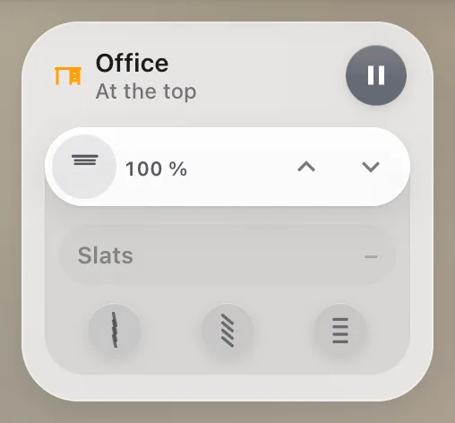

# Blind

`custom:glass-blind`

A room's blind – or anything else that opens and closes: its position and its slats' tilt as two bars – tap anywhere on a bar or drag it – with quick choices under each, a stop button while it moves and the pause of the room's automation, its time left drawn as a ring.



**Good for:** blinds with tilting slats, rollers and shutters, gates, garage doors, windows – any cover.

## Quick start

```yaml
type: custom:glass-blind
entity: cover.office_blind
name: Office
icon: mdi:desk
pause: switch.office_blind_pause    # optional: the automation's pause for this room
pause_duration: 3600                # s – for the ring
positions:                          # quick positions (default: up / down)
  - { name: Up, icon: mdi:arrow-up, value: 100 }
  - { name: Down, icon: mdi:arrow-down, value: 0 }
tilts:                              # quick tilts (default: closed / half / open)
  - { name: Min, value: 20 }
  - { name: Mid, value: 50 }
  - { name: Max, value: 80 }
```

A quick choice either sets a value (0–100) or runs a script: `{ name: Mid, script: script.office_tilt_mid }` – handy when your blinds need their own sequence.

A tilt without an `icon` shows the slats as that tilt sets them (0 = shut, 100 = flat open; a script's by its place in the list – first shut, last open). In the Studio the three default tilts are listed under **Slats**, ready to change.

### Glass icons

The cards bring their own icons for blinds, drawn with three slats so they stay bold at small sizes. They work anywhere an icon does – in this card's quick choices, a room card's buttons, any other card – and are in Home Assistant's icon picker (search *glass*):

| Icon | What |
| --- | --- |
| `glass:blind` | a blind down |
| `glass:blind-half` | half way |
| `glass:blind-open` | pulled up |
| `glass:slats-shut` | slats from the side, shut |
| `glass:slats-half` | half open |
| `glass:slats-open` | flat open |

## Kinds

`kind` says what the cover is. Left out (or `auto`), the card goes by the entity: a gate, garage door, door, window or damper (its device class) is a gate; a cover with tilting slats – or with your own `tilts` – a blind; anything else a roller.

| | `blind` | `roller` | `gate` |
| --- | --- | --- | --- |
| For | blinds with tilting slats | blinds, rollers, shutters, awnings without tilt | gates, garage doors, doors, windows… |
| The bar fills | as far as it is down | as far as it is down | as far as it is open |
| Coloured (`active_color`) | while down | while down | while open |
| Words | Open · Closed · Partially open · 45 % | the same | the same |
| Quick choices (default) | Up, Down | Up, Down | Close, Open |
| Symbol on the bar | the slats as they hang | the same | the entity's: gate, garage, door, window – open or closed |
| Slats' drawer | yes (`slats`) | – | – |

```yaml
type: custom:glass-blind
entity: cover.gate
kind: gate
name: Gate
```

A cover that can only open and close – no position, as most gates – gets a bar that shows its state and the buttons, not a slider: it is never moved by a slip of the finger.

## While it moves

- The symbol on the bar blinks and the bar says *Opening* or *Closing* with the position on the way.
- A position set on the bar (a tap, a drag or a quick choice) shows faintly, uncoloured, from the bar's start to where the blind is going; the fill follows the blind there, and the mark goes when it arrives.
- The quick choices make way for a **stop** button (when the cover can stop).
- A cover that doesn't report *opening* / *closing* counts as moving from a tap until it reaches the position sent.

## Tips

- Tap the button at the start of the position bar to go all the way up or down (a gate: open or closed) – or to stop it while it moves. With that, `show_positions: false` drops the quick positions from the bar.
- `slats: bar` – the tilt bar without quick choices; `slats: none` – no drawer, though the blind tilts.
- `percent_only: true` – both bars say just the number (*45 %*), no *Closed*, *Partially open* or *Closing*; a cover that only opens and closes keeps its words.
- `show_bar_text: false` – no state or percentage on the position bar; they go under the name. Without the button too (`show_icon: false`), the arrows sit at the bar's two ends.
- A very narrow tile (three in a row on a phone) does that by itself: the state under the name (*29 %*), the bar with the button alone – a tap goes all the way, a drag sets the position – or, without the button, the arrows at its ends.
- `show_title: false` – no icon, name and state above the bars; with `hide_pause: true` (or no `pause`) as well, there's no row at all and the card is just its bars – compact, e.g. in a pop-up with its own heading.
- With the [automation cards](../automation-cards.md) the blinds can follow the sun.

## Options

<!-- options -->
| Option | Type | What it does |
| --- | --- | --- |
| `entity` **required** | string | Entity |
| `kind` | "auto" \| "blind" \| "roller" \| "gate" | what it is: a blind with tilting slats, a roller (no tilt), a gate / garage door / window; auto = by the entity |
| `name` | string | Name |
| `icon` | string | Icon |
| `pause` | string |  |
| `pause_duration` | number |  |
| `positions` | Choice[] |  |
| `tilts` | Choice[] |  |
| `slats` | "full" \| "bar" \| "none" | the slats in the drawer (a blind): their bar and quick tilts, the bar only, or no drawer |
| `hide_pause` | boolean | Hide the pause button |
| `show_positions` | boolean | the quick positions on the bar (default shown); the button on the bar still goes all the way up / down |
| `percent_only` | boolean | the bars' states as numbers only – "45 %", not "Closed" / "Partially open · 45 %" / "Closing" |
| `show_title` | boolean | the title above the bars: the icon, name and state (default shown) – off, and with no pause button either, the card is just its bars |
| `show_icon` | boolean | the blind's button on the position bar (default shown) |
| `show_bar_text` | boolean | the state and percentage on the position bar (default shown) – off, they go under the name; a very narrow tile drops them from the bar itself |

#### Look

Materials and colours of the card's parts – set them in the card's **Appearance** tab, or here.

| Option | Type | What it does |
| --- | --- | --- |
| `active_color` | string | the blind down / the gate open (bar fill, icon); the pause ring – default orange |
| `pause_color` | string | Colour of the pause (a tint of its material). |
| `pause_glass` | material | the pause button: its material (default Apple Home's dark glass) and a tint over it |
| `pause_button_color` | string | Colour of the pause button (a tint of its material). |
| `positions_glass` | material | the quick choices: the positions on the bar (default none) and the tilts in the drawer (default dark) |
| `tilts_glass` | material | Material of the tilts – see [Materials](../appearance.md#materials). |
| `choices_color` | string | Colour of the choices (a tint of its material). |
| `bar_glass` | material | Material of the bar – see [Materials](../appearance.md#materials). |
| `bar_color` | string | Colour of the bar (a tint of its material). |
| `slats_glass` | material | Material of the slats bar – see [Materials](../appearance.md#materials). |
| `slats_color` | string | Colour of the slats bar (a tint of its material). |
| `tray_glass` | material | Material of the drawer under a bar – see [Materials](../appearance.md#materials). |
| `tray_color` | string | Colour of the drawer under a bar (a tint of its material). |
| `icon_glass` | material | Material of the icon – see [Materials](../appearance.md#materials). |
| `icon_on_glass` | material | Material of the icon while on – see [Materials](../appearance.md#materials). |
| `icon_background` | string |  |
| `fill_color` | string | Colour of the fill (a tint of its material). |
| `fill_style` | "fade" \| "solid" \| "glow" \| "none" |  |
| `fill_strength` | number | Fill strength (%) |
<!-- /options -->

---

[All cards](../README.md#the-cards) · [Look and feel](../appearance.md) · [Actions and conditions](../actions-and-conditions.md)
