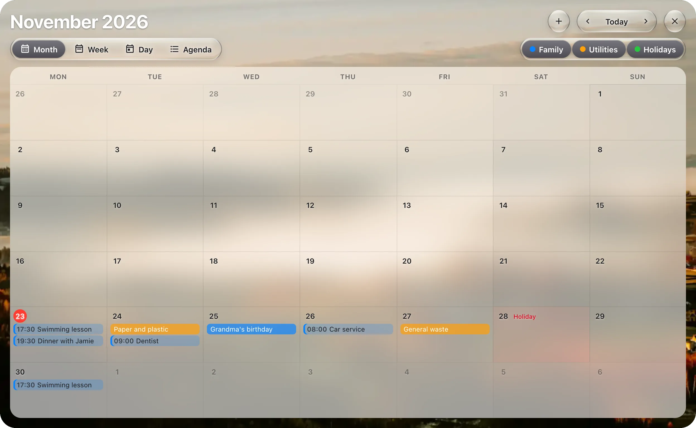
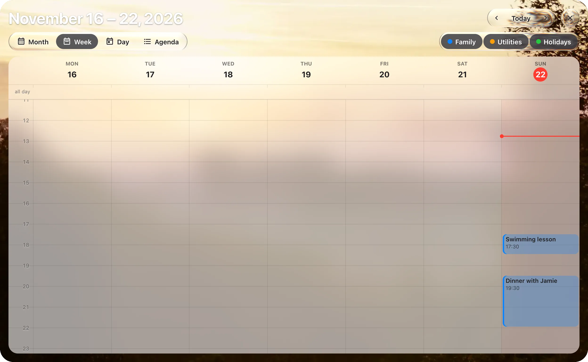
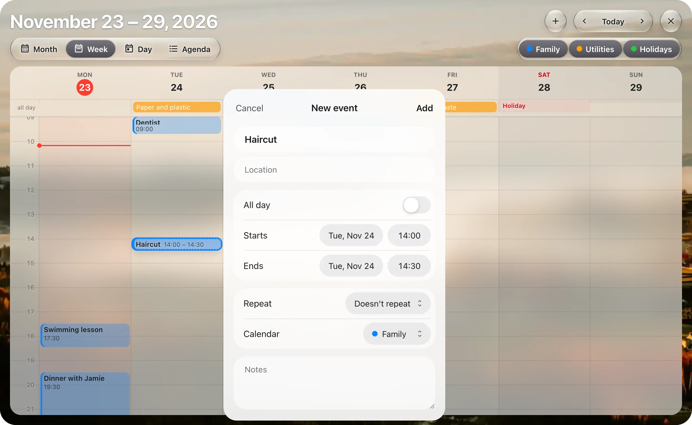
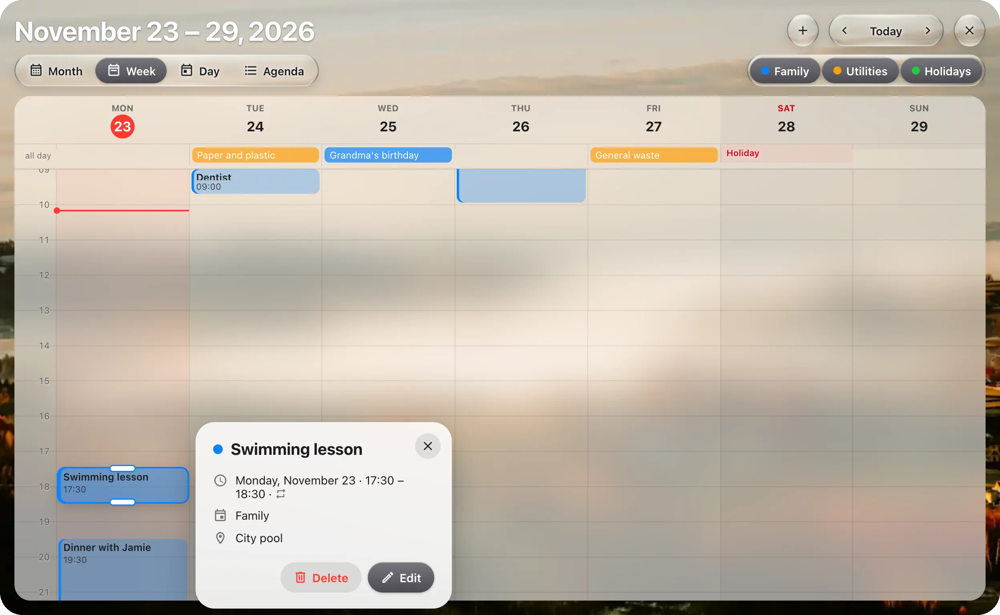
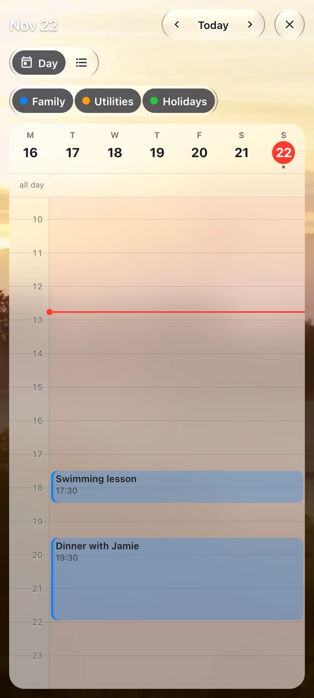

# Full calendar

`custom:glass-calendar-view`

A full-size calendar: a month, a week, a day or the agenda of your calendars – add events, change them, drag them to another time and delete them. It sits on a photo of the month, on frosted glass, with switches of real liquid glass. It opens when you tap the [Calendar](calendar.md) card, or it can sit in a pop-up or a view of its own.



## Open it

- **From the Calendar card** – tap the card. The view opens over the dashboard with the same calendars; ✕ or Esc closes it. Settings for it go under the Calendar card's `calendar_view`:

  ```yaml
  type: custom:glass-calendar
  calendars: [calendar.family, calendar.work]
  calendar_view:
    days_off: [calendar.czech_holidays]
  ```

  A `tap_action` of the Calendar card's own replaces this.
- **As a card** – in the Dashboard Studio (or *Add card* in Home Assistant) pick **Full calendar**: in a Bubble Card pop-up, or a view of its own. In a pop-up it has a ✕ that closes the pop-up (`close: false` to leave it out). With no calendars set it shows every calendar of Home Assistant.

## The views

| | |
| --- | --- |
| **Month** | The whole month; a tap on a day's number opens that day, a tap on the day adds an event |
| **Week** | Seven days: all-day events on top, the others on a time line, a red line at the current time |
| **Day** | One day on a time line |
| **Agenda** | What's coming, day by day (`agenda_days`, default 30) |



**‹ Today ›** move back and forward; on a touch screen, swipe across the view. A tap on an event shows it: when, which calendar, where and its description, and whether it repeats.

The views, the calendars and ‹ Today › are segmented switches: one track of liquid glass over the photo (`controls_glass`), the picked item a solid pill in it. Tap a calendar to hide it or show it again.

### Add, change, delete

**+** at the top adds an event – or tap where it should be: a day of the month (its number opens the day instead), a free time in the week or the day (at that half hour), or the *all day* row (an all-day event). A new event is half an hour long: a dashed outline in its calendar's colour shows where it will be, and on a tablet or a computer its form opens beside it. Pick its calendar, the name, when, whether it repeats (every day, week, month or year), where, and notes – the outline follows what you set. The dates and times have pickers of their own: a month to tap a day in, and wheels for the time.



**Tap an event** – as in Outlook, it gets a ring in its colour and its detail opens beside it (on a phone, from the bottom): when, which calendar, where, its notes and whether it repeats. Now:

- **drag it** to move it – in the week or the day to another time or day, in the month to another day. It lifts while it moves, a dashed outline shows where it was, and it settles where you drop it;
- **drag its top or bottom handle** to start it earlier or end it later.

Times snap to the half hours. Dragging never scrolls the page or the Bubble Card pop-up it sits in. A repeating event moves just that day.



In the detail, **Edit** or **Delete** the event. A repeating event asks whether it's just this one or this one and the ones after it.

What you can do depends on the calendar – Home Assistant says it:

| Calendar (e.g.) | Add | Change | Delete |
| --- | --- | --- | --- |
| **Local calendar** | ✓ | ✓ | ✓ |
| **Google Calendar** | ✓ | – | ✓ |
| **Holiday**, a calendar from a link (ICS) | – | – | – |

Other calendars as their integration allows. The buttons show only where the calendar allows them; with no calendar to add to, there's no **+**.

### On a phone



A month doesn't fit a phone, so a phone offers **Day** and **Agenda** (`phone_views`). The day shows its week above it: tap a day to open it. On a small phone the views not picked show only their icon. An event opens from the bottom of the screen.

## Weekends

Saturdays and Sundays are lightly shaded (`weekends: tint`). `plain` draws them as any other day; `hide` leaves them out of the week and the month (a five-day week).

## Days off

Calendars in `days_off` – public holidays from the **Holiday** integration, your vacation – don't add events: their all-day events tint the day and put its name beside the date. The week and the day show the name in their *all day* row. Turn their pill off to hide them.

## The photo

By default each month has its own photo: snow in sunlight for January, blossom for April, lavender for July, a foggy valley for November… Which month gets which photo follows the seasons of where Home Assistant is: in the southern hemisphere July gets a winter photo. Set `hemisphere: north` or `south` to choose it yourself.

| `image` | |
| --- | --- |
| `months` (default) | A photo for each month |
| `glass:hills-day` | One of the cards' wallpapers for every month (`glass:dunes-day`, `glass:sea-day`, `glass:pastel-waves-day`…) |
| `custom` with `image_url: /local/photo.jpg` | A picture of your own for every month (as the editor writes it); `image: /local/photo.jpg` or `https://…` does the same |

A picture of your own for some months, the others as `image` sets them:

```yaml
type: custom:glass-calendar-view
images:
  12: /local/christmas.jpg
  7: /local/holiday-2025.jpg
```

In the card's editor, **Background** picks it: *A photo for each month*, one of the cards' wallpapers, or *A picture of your own* (`image: custom` with `image_url`).

The calendar itself sits on frosted glass – light by day, dark at night (it follows the dashboard's day and night), and light on any screen. The switches are the real liquid glass (WebGL), dark liquid glass at night; the picked item is a graphite pill by day, sunk into the glass at night. In the dark the photo dims.

### Appearance

As every card, the **Appearance** tab sets each part: the material and colour of the switches (`controls_glass`, `controls_color`) and of their picked item (`picked_color`), of the calendar (`panel_glass`, `panel_color`) and of an event's detail and form (`sheet_glass`, `sheet_color`), the colour of today (`today_color`), and the fonts and icons of the header, the calendar and the detail. `panel_glass: liquid-gl` puts the calendar on real liquid glass too, at a cost on weaker tablets.

## Options

<!-- options -->
| Option | Type | What it does |
| --- | --- | --- |
| `calendars` | (Src \| string)[] | the calendars: an entity or { entity, name, color } (default: every calendar of Home Assistant) |
| `days_off` | string[] | calendars whose all-day events tint their day instead of showing as events – public holidays, your vacation |
| `view` | View | what it starts with: month, week, day or agenda (default week; a phone: day) |
| `views` | View[] | the views offered on a wide screen (default month, week, day, agenda) |
| `phone_views` | View[] | the views offered on a phone (default day, agenda) |
| `image` | string | months (default): a photo for each month; one picture for all – glass:hills-day (a wallpaper of the cards); custom: image_url |
| `image_url` | string | image: custom – a picture of your own for every month: /local/x.jpg, https://… |
| `images` | map of string | a picture of your own for a month: { 12: /local/xmas.jpg } |
| `hemisphere` | "auto" \| "north" \| "south" | which photos fit the season: auto (Home Assistant's location, default), north or south |
| `weekends` | "tint" \| "plain" \| "hide" | weekends: tint (default) – a shade on Saturday and Sunday; plain; hide – the week and the month without them |
| `agenda_days` | number | the agenda: how many days ahead (default 30) |
| `height` | string | the card's height on a dashboard (default 640px) |
| `close` | boolean | in a Bubble Card pop-up: a close button (✕) that closes the pop-up (default true) |

#### Look

Materials and colours of the card's parts – set them in the card's **Appearance** tab, or here.

| Option | Type | What it does |
| --- | --- | --- |
| `panel_glass` | material | the calendar's own glass over the photo (default light frosted glass, dark in dark mode – no WebGL) |
| `panel_color` | string | Colour of the panel (a tint of its material). |
| `controls_glass` | material | the switches' track – views, calendars, ‹ Today › (default liquid-gl; dark-liquid-gl in dark mode); the picked item is a solid pill in it |
| `controls_color` | string | Colour of the controls (a tint of its material). |
| `picked_color` | string | the picked item in the switches (default dark grey by day, sunk in at night) |
| `sheet_glass` | material | an event's detail and the event form (default as the panel) |
| `sheet_color` | string | Colour of the sheet (a tint of its material). |
| `today_color` | string | today and the time now: the date's circle, the line (default red) |
<!-- /options -->

---

[All cards](../README.md#the-cards) · [Calendar](calendar.md) · [Look and feel](../appearance.md)
