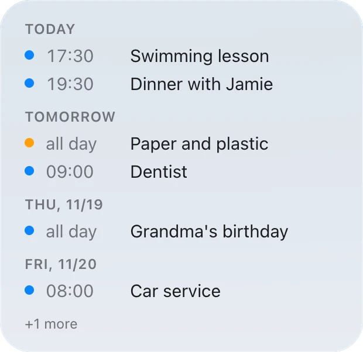

# Calendar

`custom:glass-calendar`

Upcoming events from one or more calendars, grouped by day – Today, Tomorrow, then the dates. Each calendar has its colour. The idea follows [atomic-calendar-revive](https://github.com/totaldebug/atomic-calendar-revive) by [totaldebug](https://github.com/totaldebug).



**Good for:** the side column.

## Quick start

```yaml
type: custom:glass-calendar
days: 5
max_events: 6
calendars:
  - entity: calendar.family
    color: blue
  - entity: calendar.waste_collection
    color: green
```

## Tap it

A tap opens the [Calendar view](calendar-view.md) over the dashboard: the month, the week, a day or the agenda of the same calendars, on a photo of the month. Its settings go under `calendar_view`. For Home Assistant's own calendar instead, set **A tap opens** in the card's editor to *Home Assistant's calendar* (`tap_opens: ha`); a `tap_action` of your own replaces both.

```yaml
calendar_view:
  days_off: [calendar.czech_holidays]   # holidays tint their day
```

## Tips

- `fit: true` – in a column it takes the space left, scrolls inside and fades out at the bottom.
- Events load when the card appears, when a calendar changes, every 15 minutes and after midnight – never on unrelated changes.

## Options

<!-- options -->
| Option | Type | What it does |
| --- | --- | --- |
| `calendars` | (CalendarSource \| string)[] |  |
| `entities` | string[] | Entities |
| `days` | number | Days |
| `max_events` | number | Max. events |
| `show_location` | boolean | Show location |
| `show_title` | boolean | Show title |
| `title` | string | Title |
| `hide_empty` | boolean | Hide when empty |
| `fit` | boolean | Fit the free space (scroll inside) |
| `tap_action` | action | Tap |
| `calendar_view` | map of unknown | a tap (with no tap_action of its own): the calendars in full – glass-calendar-view's settings |
| `tap_opens` | "glass" \| "ha" | what a tap opens (with no tap_action of its own): glass – the calendars in full over the dashboard (default); ha – Home Assistant's own calendar |

<!-- /options -->

---

[All cards](../README.md#the-cards) · [Look and feel](../appearance.md) · [Actions and conditions](../actions-and-conditions.md)
