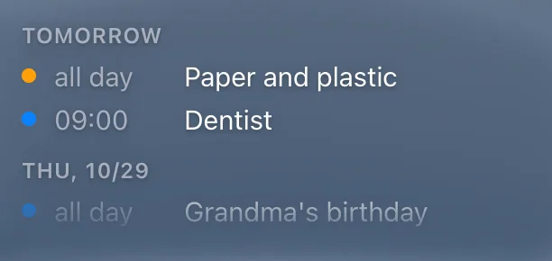

# Calendar

`custom:glass-calendar`

Upcoming events from one or more calendars, grouped by day – Today, Tomorrow, then the dates. Each calendar has its colour.



**Good for:** the side column.

## Quick start

```yaml
type: custom:glass-calendar
days: 5
max_events: 6
calendars:
  - entity: calendar.family
    color: blue
  - entity: calendar.waste_collection
    color: green
```

## Tips

- `fit: true` – in a column it takes the space left, scrolls inside and fades out at the bottom.
- Events load when the card appears, when a calendar changes, every 15 minutes and after midnight – never on unrelated changes.

## Options

<!-- options -->
| Option | Type | What it does |
| --- | --- | --- |
| `calendars` | (CalendarSource \| string)[] |  |
| `entities` | string[] | Entities |
| `days` | number | Days |
| `max_events` | number | Max. events |
| `show_location` | boolean | Show location |
| `show_title` | boolean | Show title |
| `title` | string | Title |
| `hide_empty` | boolean | Hide when empty |
| `fit` | boolean | Fit the free space (scroll inside) |
| `tap_action` | action | Tap |

<!-- /options -->

---

[All cards](../README.md#the-cards) · [Look and feel](../appearance.md) · [Actions and conditions](../actions-and-conditions.md)
