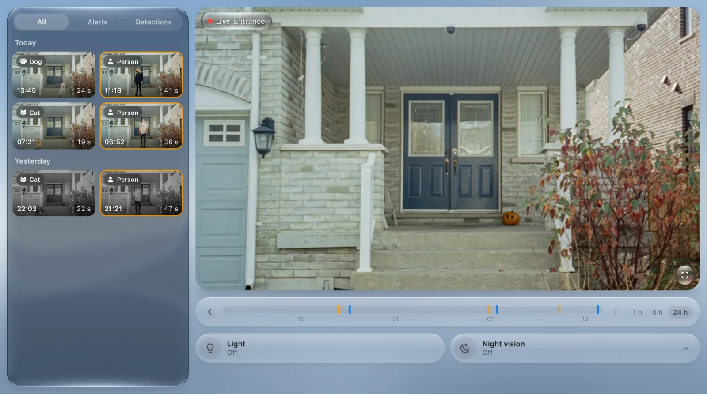
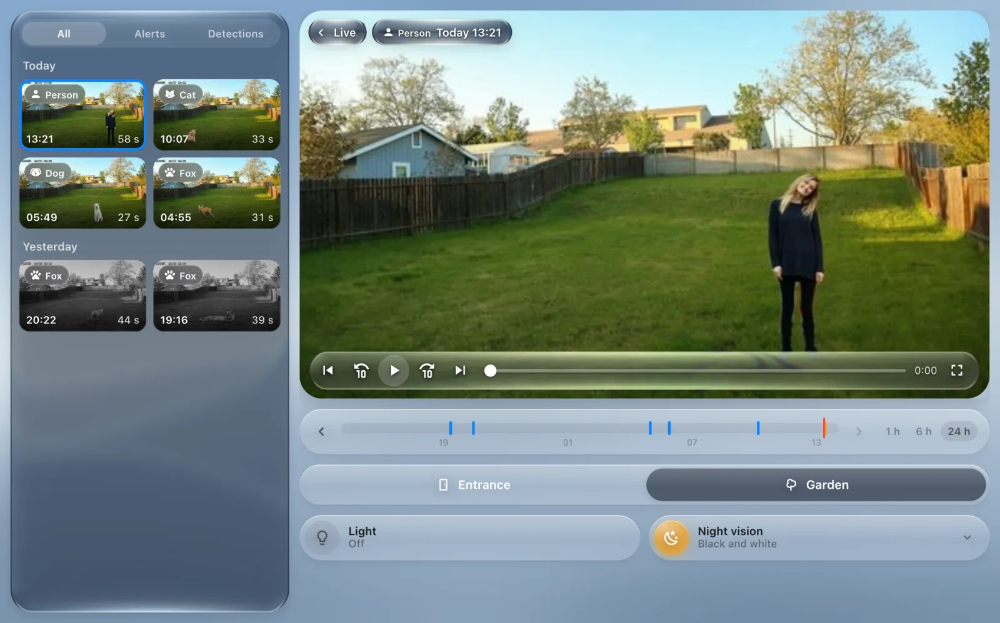

# Camera

`custom:glass-camera`

Shows a camera's live picture and the recordings Frigate made. A tapped recording plays in the same place as the live picture. Under the picture can be the camera's own entities, such as a light or night vision.

On a wide card the recordings are a column on the left and the picture is on the right. On a narrow card (a phone) the picture is on top and the recordings are below it.



## What it needs

**For the live picture (required):**

- The **WebRTC Camera** integration, installed from the Marketplace (repository `AlexxIT/WebRTC`) and added in *Settings → Devices & services → Add integration → WebRTC Camera*. It adds the `custom:webrtc-camera` card this card uses for the live picture; without it the card can't be added in the Studio.
- A **go2rtc** server for WebRTC Camera: the one it starts by itself, or your own (its address in the integration's settings).
- A camera entity, or an RTSP address / go2rtc stream name for each camera (`url`).

**For the recordings, the time line and the objects on the picture (optional):**

- **Frigate** 0.14 or newer (older versions work with fewer details: events instead of alerts and detections).
- The **Frigate integration** from the Marketplace (repository `blakeblackshear/frigate-hass-integration`), set up with your Frigate server. It needs **MQTT** in Home Assistant, as Frigate does.
- The cameras from the Frigate integration (`camera.<name>`). For another camera entity set `frigate_camera` and `frigate_instance`.

Without Frigate the card shows the live picture and the camera's entities only.

**For the liquid glass (WebGL) on the picture:** a browser with WebGL. Without it the other materials work as usual.

## Add the card

In the Dashboard Studio pick **Glass – camera**. It starts with your first camera; add more in **Cameras**.

```yaml
type: custom:glass-camera
cameras:
  - camera: camera.front_door
    name: Front door
  - camera: camera.garden
    name: Garden
```

For a camera from the Frigate integration the card reads Frigate's camera name from the entity, so the recordings need no setting.

## The card

- **Live picture** – marked **Live** with the camera's name. Until the stream starts, the camera entity's last picture is shown.
- **Objects in view** – while Frigate's occupancy sensors (`binary_sensor.<camera>_<object>_occupancy`) are on, the object (*Person*, *Dog*…) is shown on the picture.
- **Recordings** – grouped by day, newest first, with what Frigate detected, the time and the length. Alerts have an orange ring.
- **Playing a recording** – tap it. The controls: back to live, play / pause, −10 / +10 s, newer / older recording, a slider and download. On a narrow card they are under the picture instead of on it.
- **Back to live** – 30 s after a recording ended or was paused (`return_after`; 0 keeps the recording).

## Cameras

Each camera in the list can have:

| Option | What it does |
| --- | --- |
| `camera` | The camera entity – its picture, and for a Frigate camera its recordings |
| `name`, `icon` | Shown on the picture and in the camera switch |
| `url` | The live picture: an RTSP link or a go2rtc stream's name, see [Live picture](#live-picture). Empty: the camera entity's own stream |
| `items` | The camera's own controls under the picture, see [Controls](#controls) |
| `active` | Shown while this condition holds – switched elsewhere, see [Switching cameras](#switching-cameras) |
| `frigate_camera`, `frigate_instance` | Frigate's name for the camera and the Frigate instance, when they can't be read from the entity |
| `detections` | Sensors shown on the picture while on, instead of Frigate's `binary_sensor.<camera>_<object>_occupancy` |
| `live_card` | Any other card as the live picture |
| WebRTC Camera's settings | `poster`, `mode`, `media`, `server`, `muted`, `ui`, `ptz`… for this camera, see [Live picture](#live-picture) |

## Switching cameras

With more than one camera the card shows a switch above the controls. To switch the cameras elsewhere, e.g. with a pop-up header's buttons, give each camera an `active` condition: the card shows the first camera whose condition holds and hides its own switch.

```yaml
type: custom:glass-popup-header
name: Security
icon: mdi:cctv
buttons:
  - name: Front door
    icon: mdi:door
    tap_action:
      action: perform-action
      perform_action: input_select.select_option
      target: { entity_id: input_select.security_camera }
      data: { option: front }
    active: { entity: input_select.security_camera, state: front }
  - name: Garden
    icon: mdi:tree-outline
    tap_action:
      action: perform-action
      perform_action: input_select.select_option
      target: { entity_id: input_select.security_camera }
      data: { option: garden }
    active: { entity: input_select.security_camera, state: garden }
```

```yaml
type: custom:glass-camera
cameras:
  - camera: camera.front_door
    active: { entity: input_select.security_camera, state: front }
  - camera: camera.garden
    active: { entity: input_select.security_camera, state: garden }
```

`show_switcher: true` or `false` overrides this.

## Live picture

The live picture is a WebRTC Camera card inside this card. WebRTC Camera plays the stream through go2rtc and reconnects when it drops. Its settings are passed on unchanged – set on a camera they apply to that camera, set on the card to all of them:

```yaml
type: custom:glass-camera
mode: webrtc,mse          # WebRTC Camera's settings for every camera
cameras:
  - camera: camera.front_door
    url: front_door       # a stream in go2rtc's config
    poster: image.front_door_snapshot
```

`url`, `entity`, `streams`, `poster`, `poster_remote`, `title`, `mode`, `media`, `server`, `ui`, `muted`, `background`, `intersection`, `style`, `shortcuts`, `ptz` and `digital_ptz` work as in [WebRTC Camera's documentation](https://github.com/AlexxIT/WebRTC). The card sets `ui: false` and `muted: true` unless you set them, and uses the camera's picture as the `poster`.

**Keep passwords out of the dashboard.** A dashboard's settings reach every browser that opens it. Rather than `url: rtsp://user:password@…`, name the stream in go2rtc's config (it can read the password from there) and give the card just the name. When Frigate restreams your cameras, its go2rtc has them under their names: `server: http://frigate:5000/live/mse/` with `url: front_door` plays them without any password in the dashboard.

## Controls

`items` are the camera's own entities under the picture – a light, night vision, a siren – as [status bar](status-bar.md) pills: an entity, or the same settings a pill has.

```yaml
cameras:
  - camera: camera.front_door
    items:
      - switch.front_door_light
      - entity: select.front_door_night_vision
        dropdown: true
        option_names: { "Off": "Off", "Color Night Vision": "Colour" }
```

Each camera has its own; switching cameras switches them. `controls: overlay` puts them on the picture instead.

## Full screen and zoom

The button in the picture's corner (on a recording, at the end of its controls) shows the picture full screen; the same button or Esc goes back. On an iPhone, Safari can only show a video full screen, so you get its own player there. `show_fullscreen: false` hides the button.

The picture zooms – live and a recording alike:

- **mouse:** the wheel zooms in where the pointer is; drag to move around;
- **touch:** two fingers zoom in, one finger moves around once zoomed;
- **a double tap or double click** zooms in, or back out.

Another recording, live or another camera starts from the whole picture again. `zoom: false` turns it off (then two fingers zoom the page, as the browser does).

## Recordings

The recordings come from Frigate's review items – its *alerts* and *detections* (Frigate 0.14 and newer; older versions show its events). New ones appear as Frigate records them; `hours` sets how far back (default 48).

Above the recordings is a switch: **All · Alerts · Detections**. It changes only what this screen shows. `severity` sets what the card starts with (`all`, `alert` or `detection`) and `show_severity: false` hides the switch. With Frigate before 0.14 there are no alerts or detections, so there is no switch either.

`all_cameras: true` lists every camera's recordings together, each with its camera's name; a tap switches to that camera.



## Time line

`show_timeline: true` adds a time line under the picture: the recordings as marks (alerts in orange) and the stretches Frigate recorded in grey. Tap it to play from that moment, drag it or use ‹ › to go back in time, **1 h / 6 h / 24 h** to zoom. When nothing was recorded in view it offers the latest recording.

## Layout

- `layout` – `auto` (by the card's width), `side` (recordings on the left) or `stacked` (picture on top, as on a phone).
- `list_width` – the recordings' column beside the picture, default as a dashboard's side column: `minmax(320px, 0.36fr)`.
- `list_columns` – thumbnails in a row; default as many as fit.
- `height` – `fill` reaches down to the dock or the screen's bottom; or any CSS height such as `640px`. The recordings fill it and scroll. Empty: as tall as the picture.
- `aspect_ratio` (`16/9`, `4/3`, `1/1`, `9/16` for a doorbell) and `fit` (`cover` crops the edges, `contain` shows the whole picture).
- `badge_position` – the corner for **Live** and a recording's time: `top-left`, `top-right`, `bottom-left`, `bottom-right`.
- `sticky: false` – on a phone, lets the picture scroll away with the recordings.

Parts can be turned off with `show_live`, `show_events`, `show_switcher`, `show_controls`, `show_detections` and `show_timeline`, e.g. for a card with only the recordings.

## Look

Every part has its material and colour in the Studio's **Appearance** tab: the recordings' column, the labels on the thumbnails, **Live** and the time on the picture, what the camera sees, the player, the camera switch, the controls and the time line; `alert_color` and `selected_color` colour the rings of alerts and of the recording playing.

Parts on the picture in a WebGL material (`liquid-gl`, `dark-liquid-gl`, see [Materials](../appearance.md#materials)) refract the video and are redrawn with each new video frame. Over the video the glass is blurred more and slightly darkened, so white text stays readable. These parts appear once the video's first frame is there.

## Example: a security pop-up

The cameras are switched by buttons in the pop-up's header (see [Switching cameras](#switching-cameras)); the card fills the rest of the pop-up down to the dock:

```yaml
type: custom:glass-camera
height: fill
list_glass: dark-liquid
badge_glass: liquid-gl
player_glass: liquid-gl
show_timeline: true
cameras:
  - camera: camera.front_door
    name: Front door
    url: front_door
    active: { entity: input_select.security_camera, state: front }
    items:
      - switch.front_door_light
      - { entity: select.front_door_night_vision, dropdown: true }
  - camera: camera.garden
    name: Garden
    url: garden
    active: { entity: input_select.security_camera, state: garden }
```

## Troubleshooting

**No live picture.** Check that WebRTC Camera is installed and its integration added (*Settings → Devices & services*). With `ui: true` it shows its own status – an error such as *wrong response on DESCRIBE* comes from the stream (the camera, its address, go2rtc), not from this card.

**No recordings.** The card says *No Frigate camera* when it can't tell the camera's Frigate name: check the Frigate integration, or set `frigate_camera` (and `frigate_instance`, the MQTT client id in Frigate's config).

**The time line is empty.** It shows the hours up to now; the latest recording may be older – use the button it offers, or drag back.

## Options

<!-- options -->
| Option | Type | What it does |
| --- | --- | --- |
| `cameras` | CameraDef[] | the cameras: camera, name, icon, url, items, active… – see Cameras above |
| `camera` | string | one camera: the same as cameras: [{ camera }] |
| `layout` | "auto" \| "side" \| "stacked" | auto: by the card's width (default); side: recordings left of the picture; stacked: the picture on top |
| `list_width` | string | side: the recordings' column (CSS grid track, default as a dashboard's left side) |
| `list_columns` | number | thumbnails in a row (default: as many as fit) |
| `height` | string | the card's height (CSS; vh / dvh follow the screen), or fill: down to the dock / the screen's bottom – the recordings fill it and scroll |
| `badge_position` | "top-left" \| "top-right" \| "bottom-left" \| "bottom-right" | where "Live" and a recording's time sit on the picture (detections take the other side) |
| `aspect_ratio` | string | the picture's shape: 16/9 (default), 4/3, 1/1, 9/16… |
| `fit` | "cover" \| "contain" | cover: fills the picture, the edges cropped (default); contain: the whole picture |
| `controls` | "below" \| "overlay" | the camera's entities (items): under the picture (default) or on it |
| `severity` | "all" \| "alert" \| "detection" | which recordings: all (Frigate's alerts and detections, default), alert or detection |
| `show_severity` | boolean | the switch All / Alerts / Detections above the recordings (default on) |
| `show_fullscreen` | boolean | the button that shows the picture full screen (default on) |
| `zoom` | boolean | zoom into the picture: the mouse wheel, two fingers, a double tap back (default on) |
| `hours` | number | how far back the recordings go, in hours (default 48) |
| `limit` | number | at most this many recordings (default 60) |
| `all_cameras` | boolean | recordings of every camera in the card, not only the one shown |
| `return_after` | number | seconds after a recording ended or was paused: back to live (default 30, 0 = stay) |
| `sticky` | boolean | stacked: the picture stays at the top while the recordings scroll under it |
| `show_live` | boolean | Live picture |
| `show_events` | boolean | Recordings |
| `show_switcher` | boolean | Camera switch – Default: only when no camera is switched elsewhere (its `active`, e.g. a pop-up header's buttons) |
| `show_controls` | boolean | Camera's entities |
| `show_detections` | boolean | What it sees now |
| `show_timeline` | boolean | Time line |

#### Look

Materials and colours of the card's parts – set them in the card's **Appearance** tab, or here.

| Option | Type | What it does |
| --- | --- | --- |
| `badge_glass` | material | "Live" and a recording's time on the picture: material and colour |
| `badge_color` | string | Badge color |
| `seen_glass` | material | what the camera sees now (on the picture): material and colour |
| `seen_color` | string | Colour of the seen (a tint of its material). |
| `player_glass` | material | a recording's controls: material and colour |
| `player_color` | string | Colour of the player (a tint of its material). |
| `alert_color` | string | Frigate's alerts: their thumbnails' ring and their marks on the time line |
| `selected_color` | string | the recording playing: its thumbnail's ring |
| `list_glass` | material | Material of the list – see [Materials](../appearance.md#materials). |
| `list_color` | string | Colour of the list (a tint of its material). |
| `switcher_glass` | material | material of the camera switch (default: the control glass, as the status bar's pills) |
| `switcher_color` | string | Colour of the switcher (a tint of its material). |
| `controls_glass` | material | material of the camera's entities (pills) (default: the control glass, as the status bar's pills) |
| `controls_color` | string | Colour of the controls (a tint of its material). |
| `label_glass` | material | Material of the label – see [Materials](../appearance.md#materials). |
| `label_color` | string | Colour of the label (a tint of its material). |
| `timeline_glass` | material | material of the time line (default: the control glass, as the status bar's pills) |
| `timeline_color` | string | Colour of the timeline (a tint of its material). |
<!-- /options -->
