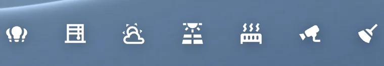

# Dock

`custom:glass-dock`

An icon bar floating at the bottom, on one capsule of liquid glass – like the macOS Dock. Its buttons switch the dashboard's pages, or open Bubble Card pop-ups by their `#link`. The current one is lit.



**Good for:** navigation on a wall tablet or a phone.

## Quick start

```yaml
type: custom:glass-dock
group: page               # buttons with an id switch pages – no pop-ups needed
indicator: dot
items:
  - { icon: mdi:home-outline, name: Rooms, id: home }
  - { icon: mdi:lightbulb-group-outline, name: Lights, id: lights }
  - { icon: mdi:thermometer, name: Climate, id: climate }
```

Put it in the dashboard's `overlay:` so it floats over everything. Cards show for a page with `visibility: [{ condition: select, group: page, id: lights }]` – see [Layout → Pages](../layout.md#pages-without-pop-ups).

### With pop-ups

```yaml
items:
  - { icon: mdi:home, home: true }          # closes any pop-up
  - { icon: mdi:lightbulb-group, link: "#lights" }
  - { icon: mdi:radiator, link: "#heating" }
```

## Tips

- `scroll: true` – full width, swiped sideways when the buttons don't fit (phones).
- `fade: true` – what scrolls under the dock dissolves into the wallpaper.
- `bare: true` – icons only, no capsule.
- `inline: true` – in a panel instead of floating (e.g. in the side column), `columns` per row.

## Options

<!-- options -->
| Option | Type | What it does |
| --- | --- | --- |
| `items` | DockItem[] |  |
| `group` | string | the select group the buttons' `id`s pick in (core/select) |
| `inline` | boolean | In a panel instead of floating |
| `columns` | number | Columns |
| `indicator` | "pill" \| "dot" | Open pop-up |
| `align` | string | Alignment |
| `bare` | boolean | Icons only (no capsule) |
| `scroll` | boolean | Swipe sideways |
| `fade` | boolean \| number | Fade content above the dock |

<!-- /options -->

---

[All cards](../README.md#the-cards) · [Look and feel](../appearance.md) · [Actions and conditions](../actions-and-conditions.md)
