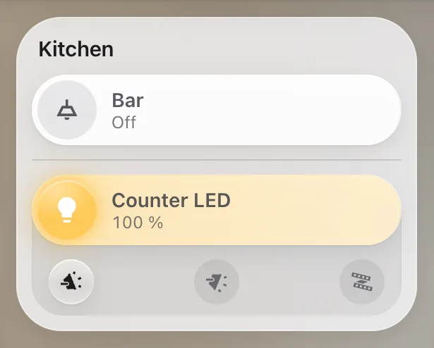

# Lights

`custom:glass-light`

A room's lights on one tile: its scenes as round buttons, and a bar of liquid glass for each light – tap the bulb to switch it, drag the bar to dim. The bar fills as bright as the light is, in the light's own colour. Lights with colour or white temperature get a switch between brightness, temperature and colour.



**Good for:** a room's pop-up or page; anywhere you dim lights.

## Quick start

```yaml
type: custom:glass-light
name: Living room
icon: mdi:sofa
scenes:
  - entity: scene.living_room_relax
    name: Relax
    icon: mdi:sofa-outline
  - entity: scene.living_room_movie
    name: Movie
    icon: mdi:movie-open-outline
lights:
  - entity: light.living_room
    name: Ceiling
    levels: [25, 50, 75, 100]       # quick brightness chips under the bar
  - entity: light.living_room_lamp
    name: Floor lamp
  - switch.bathroom_light            # a switch: on / off only
```

### More kinds of lights

```yaml
lights:
  - entity: switch.bath_1          # one bar for several: on while any is on
    entities: [switch.bath_1, switch.bath_2]
  - entity: light.led_strip
    presets: select.led_strip_preset   # its presets as chips
  - entity: scene.stars_on          # two scenes as one switch
    off_scene: scene.stars_off
```

`layout: buttons` shows the lights as round buttons instead of bars.

## Tips

- Scenes can show a picture: `image: /local/scenes/relax.png` instead of an icon.

## Options

<!-- options -->
| Option | Type | What it does |
| --- | --- | --- |
| `name` | string | Name |
| `icon` | string | Icon |
| `lights` **required** | (LightItem \| string)[] |  |
| `scenes` | (SceneItem \| string)[] |  |
| `show_name` | boolean | Show name |
| `layout` | "bars" \| "buttons" | Layout |

#### Look

Materials and colours of the card's parts – set them in the card's **Appearance** tab, or here.

| Option | Type | What it does |
| --- | --- | --- |
| `active_color` | string | Color when on |
| `pill_glass` | material | Material of the bar – see [Materials](../appearance.md#materials). |
| `pill_color` | string | Colour of the bar (a tint of its material). |
| `icon_glass` | material | Material of the icon – see [Materials](../appearance.md#materials). |
| `icon_on_glass` | material | Material of the icon while on – see [Materials](../appearance.md#materials). |
| `icon_background` | string |  |
| `modes_glass` | material | Material of the picked mode – see [Materials](../appearance.md#materials). |
| `modes_color` | string | Colour of the picked mode (a tint of its material). |
| `presets_glass` | material | Material of the picked preset – see [Materials](../appearance.md#materials). |
| `presets_color` | string | Colour of the picked preset (a tint of its material). |
| `scenes_glass` | material | Material of the scene buttons – see [Materials](../appearance.md#materials). |
| `scenes_color` | string | Colour of the scene buttons (a tint of its material). |
| `tray_glass` | material | Material of the drawer under a bar – see [Materials](../appearance.md#materials). |
| `tray_color` | string | Colour of the drawer under a bar (a tint of its material). |
| `fill_source` | "light" \| "accent" | the brightness fill in the bar: the light's own colour (default) or the card's colour when on |
| `fill_color` | string | Colour of the fill (a tint of its material). |
| `fill_style` | "fade" \| "solid" \| "glow" \| "none" | fade (default, stronger on the left), solid, glow (bright edge at the value), none |
| `fill_strength` | number | how strong the fill is, % (default 34) |
<!-- /options -->

---

[All cards](../README.md#the-cards) · [Look and feel](../appearance.md) · [Actions and conditions](../actions-and-conditions.md)
