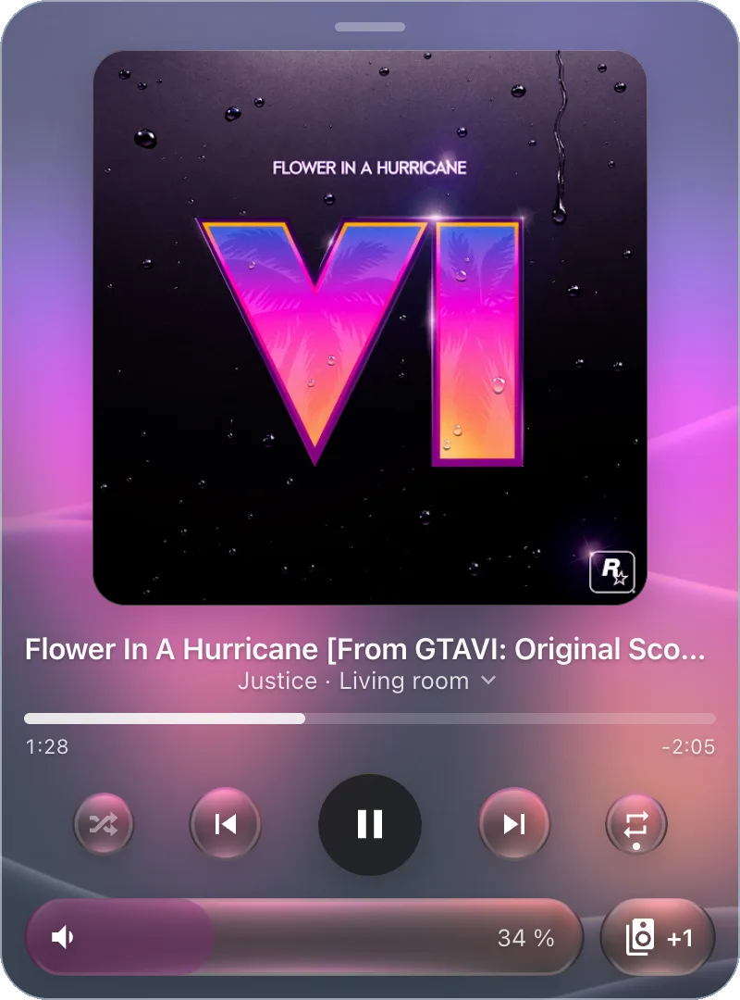
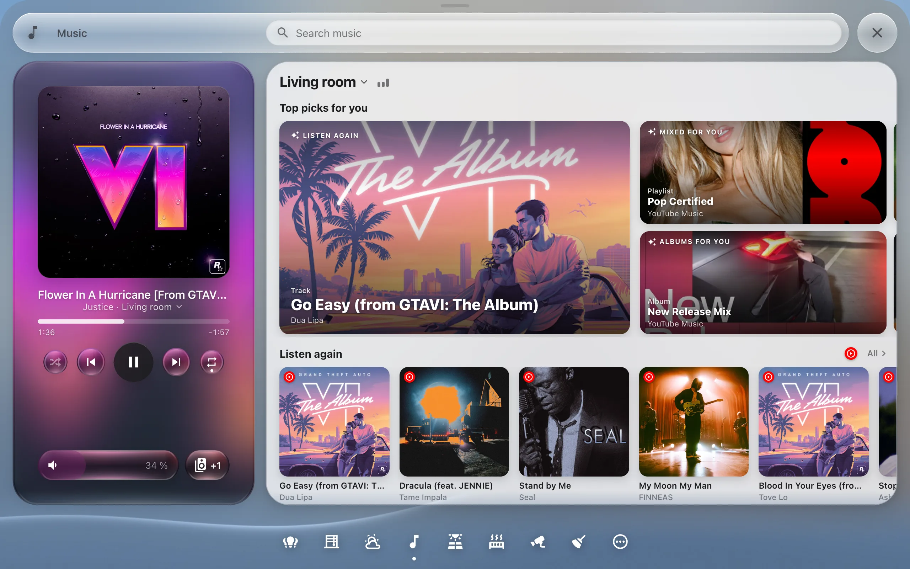
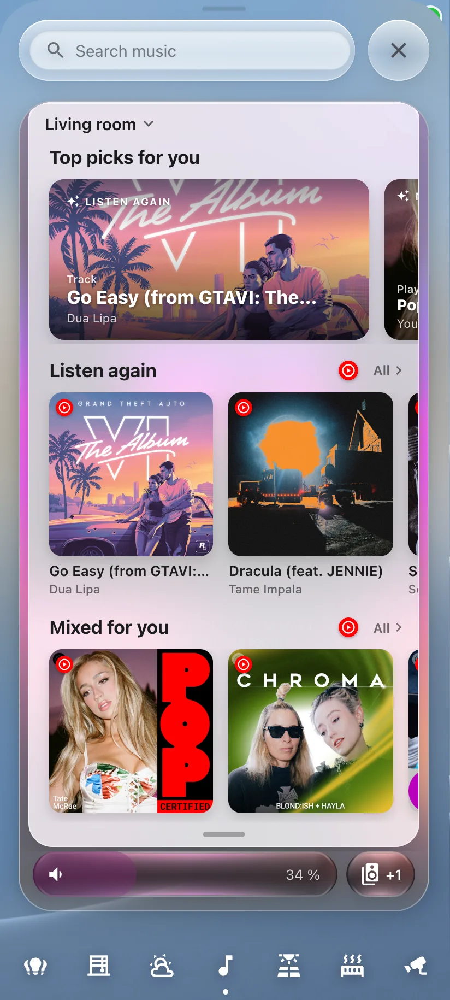
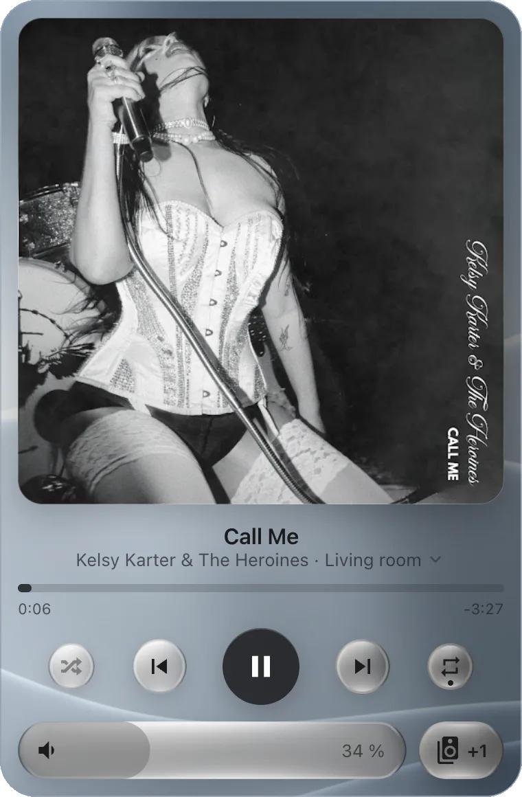
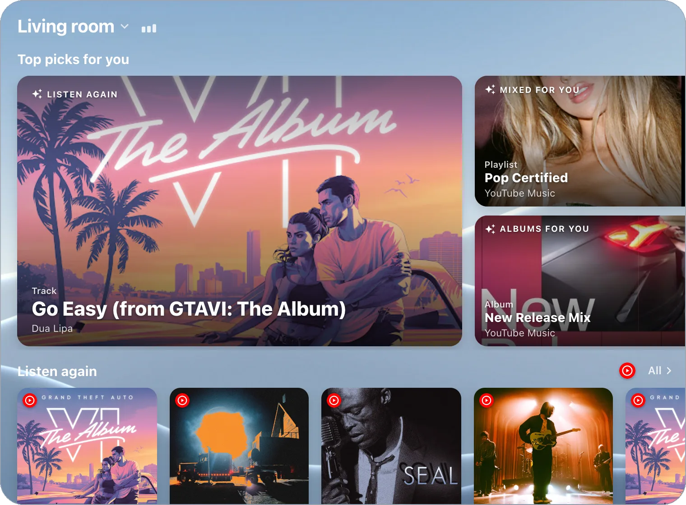
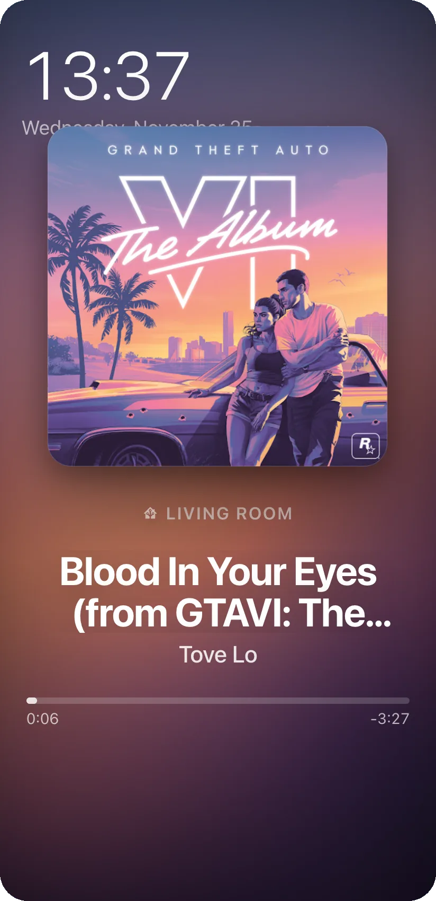
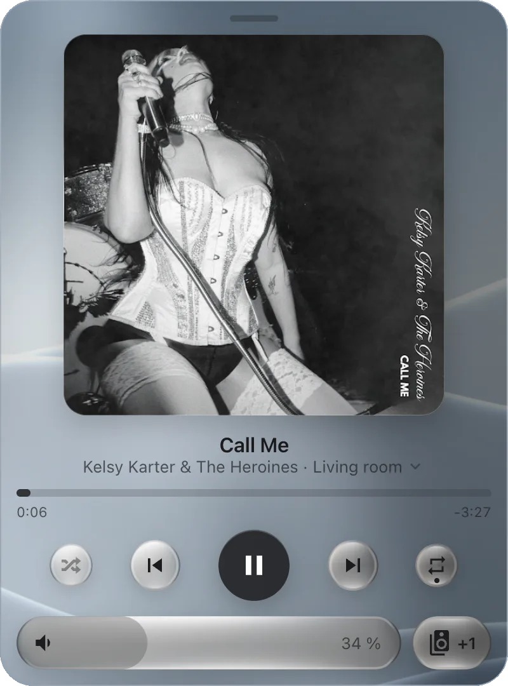
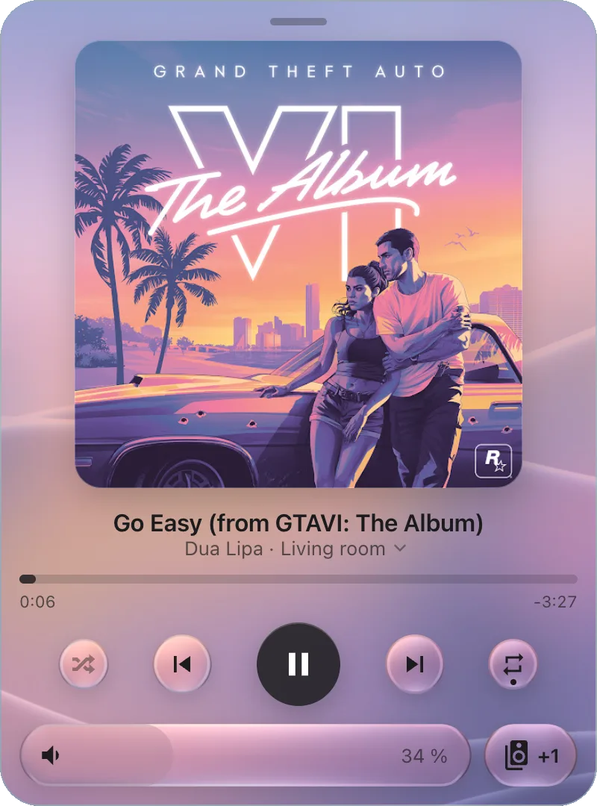
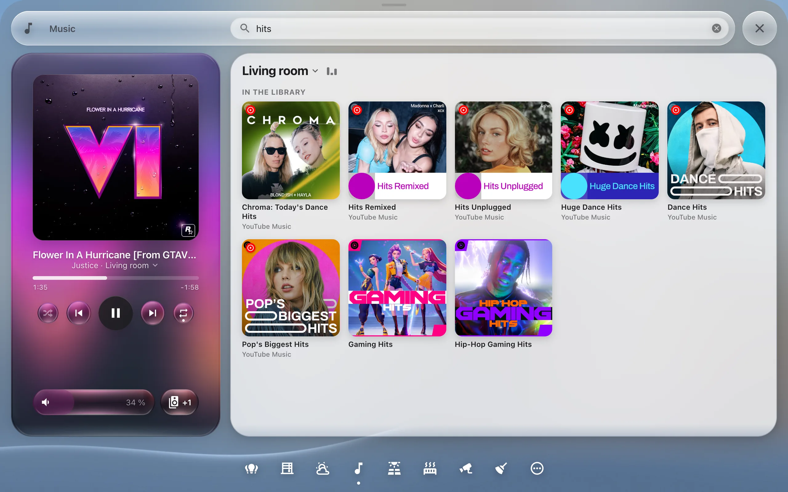
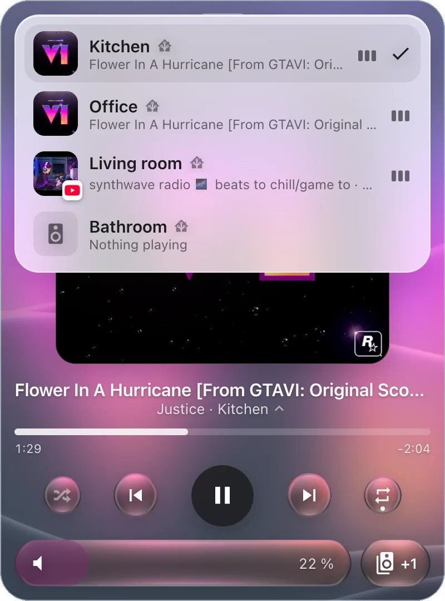

# Media player

`custom:glass-media`

The media player card brings your music onto the dashboard the way a good music app would. The cover of the song that's playing lies blurred under the glass and tints the whole card with its colours, the buttons and bars are real liquid glass on top of it, and the text switches between dark and white so it always reads well. Below the player sits your library – playlists, albums and artists in rows – so you can start something new without leaving the dashboard.

The card is built first and foremost for **[Music Assistant](https://music-assistant.io)**, including YouTube Music added to it, but it plays just as well with Plex or any other player in Home Assistant.



## Quick start

```yaml
type: custom:glass-media
entity: media_player.living_room     # the player
entities:                            # more players – the card shows the one that's playing
  - media_player.kitchen
  - media_player.bathroom
```

You can also add it in Dashboard Studio, or with *Add card* in Home Assistant – look for **Media player**.

## What it can play

The card works with three kinds of players. What you get – the library, search, grouping – depends on which one you use.

### Music Assistant – recommended

If your speakers play through Music Assistant – Sonos, Chromecast, Sendspin, AirPlay and the rest – you get everything the card can do. All you need is the **Music Assistant integration in Home Assistant**; there's nothing extra to set up in the card.

- **Your library** is Music Assistant's: playlists, albums, artists and radio from every music source you've added to it.
- **YouTube Music** – add it to Music Assistant (Settings → Music providers → YouTube Music) and your YouTube Music library shows up in the card and plays on any of your speakers.
- **Search** goes through Music Assistant, so it searches the whole catalogue of your sources – all of YouTube Music, for example.
- **Grouping** works between speakers of the same kind, see [Playing in more rooms](#playing-in-more-rooms).

The card also understands Music Assistant's quirks. A Sonos playing Music Assistant's stream, for instance, reports *idle* when you pause it – the card still shows the song as paused, with the play button ready, instead of jumping to "nothing playing".

#### Music Assistant's address and token (optional)

Home Assistant passes most of Music Assistant on to the card, but not all of it. If you give the card Music Assistant's address and a token, it can ask Music Assistant directly and you also get:

- **Music Assistant's home** at the top of the library – *Top picks for you*, *Listen again*, your mixes and albums for you, just like in Music Assistant's own app;
- **every playlist and album with all its tracks** – tap a track and the playlist plays on from there;
- **each player's kind** (Sonos, Chromecast, AirPlay…) next to its name in the list of players.

```yaml
music_assistant_url: http://192.168.1.10:8095
music_assistant_token: eyJhbGciOi…   # Music Assistant → Settings → profile → tokens
```


> **⚠ Please read this before you add the token.** The token is stored in the dashboard's configuration as plain text, and your browser sends it straight to Music Assistant. Anyone who can open the dashboard's settings – or listen to the network traffic of a dashboard opened over plain `http` – can read it and use it to control your Music Assistant. Only fill it in if you're comfortable with that and you trust the network. The card works fine without it; you just won't see Music Assistant's home rows and the tracks of every playlist. This is a deliberate trade-off: it saves you from installing a separate integration just for this card.

Because the browser talks to Music Assistant directly, it has to be able to reach that address. Note that a dashboard opened over `https` can't reach Music Assistant on plain `http`.

### Sonos with YouTube Music

Sonos speakers can play your YouTube Music too, and there are two ways to set it up:

**1. Hearted playlists in the Sonos app** – the quick one. Heart a YouTube Music playlist in the Sonos app (it lands in *My Sonos*) and it appears in the card's library for your Sonos speakers. It starts quickly and reliably, because Sonos plays it through its own YouTube Music service. The catch is that you only get the playlists you've hearted by hand. You don't need Music Assistant for this – the Sonos integration in Home Assistant is enough.

**2. Through Music Assistant** – the complete one. Add both the Sonos and the YouTube Music providers to Music Assistant, and your whole YouTube Music library and search are available on your Sonos speakers. For everything to play smoothly – pause, the song's progress, grouping – keep the **Sonos integration in Home Assistant** as well, next to Music Assistant's. Each speaker then exists twice in Home Assistant, and the card pairs them up on its own: the controls go through Music Assistant, while the speaker's own entity keeps the card informed.

### Plex

Plex works through Home Assistant's Plex integration: the library shows what you played and added recently, your playlists and the music library. Home Assistant's Plex integration has no shuffle or repeat, so the card doesn't show them either – if you play Plex through Music Assistant (with Plex as one of its music sources), you get both.

### Other Home Assistant players

Any `media_player` in Home Assistant works – a TV, an AV receiver, a Chromecast without Music Assistant. The card shows only the controls the player supports, so an Apple TV gets no shuffle and a radio no progress bar. If the player can browse its media, that's the library; if it can't, the library lists its sources (radio stations – inputs such as HDMI are left out).

#### YouTube Music without Music Assistant

With the [YouTube Music Player](https://github.com/KoljaWindeler/ytube_music_player) integration (HACS) you can use YouTube Music's library for your speakers:

```yaml
type: custom:glass-media
entity: media_player.kitchen
entities: [media_player.living_room, media_player.bathroom]
library_from: media_player.ytube_music_player   # YouTube Music's library for these speakers
```

Tapping a playlist tells YouTube Music to play it on the speaker you picked; next, pause and the rest then go to YouTube Music, which holds the queue. To sign the integration in, follow [ytmusicapi's browser setup](https://ytmusicapi.readthedocs.io/en/stable/setup/browser.html) and copy the resulting `browser.json` to `/config/.storage/header_ytube_music_player.json`. Be aware that YouTube sometimes refuses to hand out a song's stream (`self decoded url return 403` in the log) – the speaker then has nothing to play. That's between the integration and YouTube; Music Assistant is the more dependable way.


## Layouts

The same card adapts to where you put it.

### A tablet: the player and its library side by side

On a tablet you can split a pop-up in two – the player on the left, the library on the right and a search in the header, as in the demo's **Music** pop-up. It takes two cards with the same players, one with `show: player` and one with `show: library`. They link up by themselves: pick a different player on the left and the library on the right follows, and anything you tap in the library plays on that player. In a panel, the cover tints the whole panel right up to its rounded edges.



The pop-up's YAML:

```yaml
type: custom:bubble-card
card_type: pop-up
hash: "#music"
show_header: false
width_desktop: 1280px
cards:
  - type: custom:glass-popup-header
    name: Music
    icon: mdi:music-note
    search: true                      # a search field that searches the library below
    search_placeholder: Search music
    title_width: calc(max(340px, calc((100cqw - 22px) * 0.36 / 1.36)) - 20px)
  - type: custom:glass-panel
    glass: none
    layout: row
    gap: 16
    padding: 0
    align: stretch
    height: 624px
    cards:
      - type: custom:glass-panel
        role: sidebar                 # the side panel's dark glass
        padding: 22
        view_layout: { grow: 0, shrink: 0, basis: "max(340px, calc((100% - 22px) * 0.36 / 1.36))" }
        cards:
          - type: custom:glass-media
            entity: media_player.living_room
            entities: [media_player.kitchen, media_player.bathroom]
            show: player
      - type: custom:glass-media
        entity: media_player.living_room
        entities: [media_player.kitchen, media_player.bathroom]
        show: library
        view_layout: { grow: 1, basis: 0px }
```


### A phone

On a phone one card does both jobs. With `fill_height: true` it fills the screen down to the dock: the cover as large as it fits and the volume at the bottom. The library slides up over the player from the handle at the top.

| | |
| --- | --- |
|  |  |

### The library over the card

By default (`show: all`) the library lives on top of the player. While nothing is playing it stays open; once music plays it slides up to a small handle, and a tap on the handle brings it back. It tucks itself away again after a few seconds without a touch (`library_close`, 8 seconds by default, `0` keeps it open). If you'd rather have it permanently below the player, use `library_layout: below`.

| | |
| --- | --- |
|  |  |

### Just the player, or just the library

You can also use each half on its own: `show: player` for a player without the library, `show: library` for a library card that's always open, with the player's name at the top to switch players.

| | |
| --- | --- |
|  |  |

### A tile

`layout: tile` shrinks the player to a single pill with the cover, what's playing and play / pause. The pill itself is the volume control – just drag along it.


### A screensaver

`layout: screen` turns the player into a full-screen view made for the effect: the cover large over a slowly drifting blurred copy of itself, the song in big type, and the time and date in the corner (`clock: false` hides them). When nothing is playing, it shows a large clock instead. After five seconds without a touch the buttons and the cursor fade away; a touch brings them back, with play / pause as the largest button.




Put the card on its own in a dashboard (a panel view) and point your kiosk app's screensaver at that dashboard – whenever music plays, the screensaver shows it.

```yaml
type: custom:glass-media
entity: media_player.living_room
entities: [media_player.kitchen]
layout: screen
```

## Playing music

### The controls

Play / pause is the solid button in the middle; it reacts the moment you press it, even if the player itself takes a few seconds to follow (Plex does). Previous, next, shuffle and repeat appear when the player supports them – shuffle and repeat light up when they're on, and repeat cycles through *all → one → off*. You can tap or drag the progress bar to jump in the song, and drag the volume bar to change the volume; the speaker icon on it mutes and unmutes.

A tap on the cover opens the visualizer, and holding it opens Home Assistant's more-info dialog (`hold_action`).

### The cover's colours

Every cover tints the card its own way – here's the same card with four different songs:

| | |
| --- | --- |
|  |  |
|  |  |

On a wider card the cover moves to the left:


At night the cover dims and the glass turns dark (switch the page to night mode to see it). When you pause, the cover dims a little but the colours stay. `art_glass` lets you choose the glass yourself – `liquid` (light, dark text) or `dark-liquid` (dark, white text) – and `art_background: false` leaves the cover out altogether.

### The visualizer

Tap the cover and it turns into the cover's own colours moving to the music; tap again for the cover. Swipe sideways to switch between three looks: **Ring** (blocks around the centre pushed out by the beat), **Bars** (bars up and down from a middle line) and **Orbit** (the cover breathing in a circle with dots of its colours around it). Your browser remembers your choice for every media card.

Home Assistant never gives the card the actual sound – the speaker plays it, not the browser – so the visualizer composes its own: a beat, hi-hats and a melody based on the song, following where you are in it. It pauses when you pause and takes almost no power. If you'd rather the tap did something else, set `visualizer: false` and the cover uses `tap_action` instead.

## The library

The library shows what the player can browse, in rows just like a music app: what you've played, what's new, playlists, albums, artists and radio. Artists are round, albums and playlists square.

- **Swipe a row** sideways and the library up and down (with a mouse, drag). Inside a Bubble Card pop-up it never drags the pop-up along.
- **All ›** opens the whole row, and an artist opens their albums.
- **Tap a cover** to play it. A spinner shows until the player starts, and the card stays on that player meanwhile.
- **Hold a playlist or an album** (or right-click it) to open it: its cover, a play button and its tracks. Tap a track to play it – with [Music Assistant's token](#music-assistants-address-and-token-optional) the playlist then plays on from that track.

### Search

If you turn on `search: true` in the [pop-up header](popup-header.md), you get a search field that's linked to the library in the same pop-up – there's nothing else to set. As you type, the library turns into a grid: first what matches in the rows already loaded, then, once you pause, what the player's own search finds (Music Assistant searches all of YouTube Music, for example). ✕, Esc or an empty field bring the rows back.



> In the web demo the search only finds what's already in the demo's library.

### Your own rows

You can add covers of your own – a radio stream, a favourite playlist – and they come first, grouped into rows by `row`:

```yaml
favorites:
  - name: Morning radio
    image: /local/covers/radio.jpg
    row: Radio
    media_content_id: http://radio.example/stream.mp3
    media_content_type: music
  - name: Kitchen jazz
    source: Jazz FM          # or one of the player's sources
```

`library_sections` lets you pick which rows to show and in what order (by their titles), and `library: false` turns the library off.

## Playing in more rooms

### Switching between players

List more players in `entities` and the card shows the one that's playing. When you pause, it stays on that player so play is right at hand, and it only moves on when another player starts. A tap on the player's name (▾) lists them all, each with its cover and what it plays; the one you pick stays until another one starts playing after it.

A tablet that lives in one room can stay with that room's speaker instead: with `follow_playing: false` the card always shows `entity`. You can still pick another player by hand – it stays while something plays on it, then the card goes back to its own.



### Grouping speakers

The button to the right of the volume bar lets you group speakers, so they all play the same thing. Tick a speaker and it joins, untick it and it leaves; each one keeps its own volume bar, and the button shows how many play along (`+1`).


You can only group players of the same kind – Sonos with Sonos, Chromecast with Chromecast – because that's what the speakers themselves can do. The card offers exactly those, from your whole home, not just the card's `entities`. `speakers: false` hides the button.

When you look at a speaker that's silent while others are playing together, the card offers to bring it along: a bar at the top shows what's playing and where, with a **Join** button that adds this speaker to the group.


### A soundbar on the TV

A Sonos soundbar connected to the TV over HDMI only tells Home Assistant that it plays *TV Audio*. If you list the devices connected to the TV in `tv_sources`, the card shows what's actually on instead: the film, episode, video or game, with its picture, the time and play / pause. The volume still belongs to the soundbar.

```yaml
tv_sources:
  - speaker: media_player.living_room
    tv: media_player.lg_tv                 # optional: the TV, which knows the input on screen
    sources:
      - entity: media_player.plex_apple_tv # Plex on the Apple TV: the film's poster, the episode
        input: Apple TV
      - entity: media_player.apple_tv      # the Apple TV itself: the app and what it plays
        input: Apple TV
      - entity: media_player.playstation_5 # the game
        input: PS5
```

Each soundbar gets its own list. Of the devices that play or are paused, the card follows the one that changed last – you started, paused or switched something on it. When a device listed before it plays the same thing, that one shows instead, so put the richest one first: Plex knows the film and its poster, while the Apple TV knows only what the app tells it. A paused video still shows; an Apple TV on its home screen, or with only an app's menu open, counts as nothing playing. In the list of players, the soundbar shows what plays on the TV, with the small icon of the Apple TV's app (looked up in the App Store by the app's id).

Devices don't always say when you've moved on – a PlayStation may report the same game for an hour, and Plex may keep saying it plays long after you closed it. If your TV is in Home Assistant, add it as `tv` and give each device the `input` the TV calls it (its `source`, as the TV entity shows it). The card then only looks at the devices on the input that's on screen, and on any other input – an app of the TV itself, like Netflix – it shows the TV. Music from Music Assistant on the soundbar always comes first: the list only matters while the soundbar plays the TV's sound.

## Keyboard media keys

With `media_keys: true` you can control the card's player with your computer keyboard's media keys – play / pause, next and previous – even when the browser is minimised, Home Assistant is in a background tab or the card sits in a closed pop-up. Your system's own media controls (Control Center on macOS, the media flyout on Windows) show the song with its cover and work too.

Browsers only send media keys to a page that plays sound, so the tab plays a loop of silence (you'll see a speaker on it) – and browsers only allow that after you've clicked the page once, so click anywhere after Home Assistant loads. If you start Spotify or a YouTube video afterwards, it takes the keys over. This works in Chrome, Edge and Firefox; Safari is stricter and may not.

## Options

<!-- options -->
| Option | Type | What it does |
| --- | --- | --- |
| `entity` | string | the player |
| `entities` | string[] | more players: the card shows the one playing (a tap on the name picks another) |
| `follow_playing` | boolean | with more players: move to the one that starts playing (default true); false: always `entity` – one picked by hand stays while something is on it |
| `name` | string | Name |
| `layout` | "card" \| "tile" \| "screen" | card (default), tile – one pill; screen – the whole screen (a kiosk's screensaver) |
| `clock` | boolean | layout screen: the time and the date (default true) |
| `show` | "all" \| "player" \| "library" | all (default): the player with its library; player: the player alone; library: the library alone, as a card of its own (beside the player, as in a pop-up's two sides) |
| `speakers` | boolean | the button of the speakers to group with the one shown (default true) |
| `library` | boolean | show: all – the player's library (playlists, albums, artists in rows): open while nothing plays, a handle on top while it does (default true) |
| `library_close` | number | opened while something plays: down again after this many seconds without a touch (default 8; 0 = stays) |
| `library_layout` | "sheet" \| "below" | show: all – the library as a sheet over the player (default, its handle on top), or below it |
| `favorites` | Pick[] | your own covers, the first row of the library |
| `library_from` | string | the library of another player for the others (YouTube Music for a Sonos): a tap plays it through that player on the one picked |
| `library_sections` | string[] | which rows of the library, in this order (their titles); default: all, played and new first |
| `tv_sources` | { speaker?: string; tv?: string; sources: (string \| { entity: string; input?: string })[] }[] | a speaker on a TV's HDMI (a Sonos soundbar): what the TV plays, from these players – the first one playing (or paused), in this order – while the speaker plays the TV's sound |
| `music_assistant_url` | string | Music Assistant's own address (`http://…:8095`) – with a token, the card talks to Music Assistant itself: its home's rows, every playlist's tracks, each player's kind (optional) |
| `music_assistant_token` | string | a token made in Music Assistant (Settings → profile → tokens) – stored in the dashboard in plain text: anyone who can read the dashboard's configuration can read it (optional, see the docs) |
| `media_keys` | boolean | the keyboard's media keys (play / pause, next, previous) play on this card's player – also with the window minimised or the card in a closed pop-up (default false) |
| `visualizer` | boolean | a tap on the cover shows a visualizer in its place – the cover's colours moving to the music (default true; false: the tap action) |
| `tap_action` | action | Tap |
| `hold_action` | action | Hold |

#### Look

Materials and colours of the card's parts – set them in the card's **Appearance** tab, or here.

| Option | Type | What it does |
| --- | --- | --- |
| `art_background` | boolean | Blurred cover behind the glass |
| `art_glass` | "liquid" \| "dark-liquid" | the glass the cover's colours light: liquid (light) or dark-liquid; default by day and night (in a panel: by the panel) |
| `fill_height` | boolean | the card as tall as the screen lets it: down to the dock (glass-dock, Bubble Card's buttons) |
| `controls_glass` | material | the buttons and bars: real liquid glass over the blurred art (default liquid-gl; dark-liquid-gl at night) |
| `controls_color` | string | Colour of the controls (a tint of its material). |
<!-- /options -->

---

[All cards](../README.md#the-cards) · [Pop-up header](popup-header.md) · [Look and feel](../appearance.md)
