# Media player

`custom:glass-media`

A player for your speakers, made first for **[Music Assistant](https://music-assistant.io)** – and for **YouTube Music added to Music Assistant** as a music source. It works with any `media_player` of Home Assistant too: Sonos, Plex, a Chromecast…

The cover lies blurred under the glass and lights it with its colours; the buttons and bars are real liquid glass over it, and the text turns dark or white to read on whatever cover plays. Under the player is your **library** – playlists, albums and artists in rows, as a music app shows them – and a search through all of YouTube Music.


**Good for:** the speakers of a room, a pop-up with the player on one side and the library on the other, a phone's whole screen, a small tile, a kiosk's screensaver.

## Quick start

```yaml
type: custom:glass-media
entity: media_player.living_room     # a Music Assistant player
entities:                            # more players: the card shows the one playing
  - media_player.kitchen
  - media_player.bathroom
```

In the Dashboard Studio (or *Add card* in Home Assistant) pick **Media player**.

## Music Assistant

The card is made for Music Assistant's players – a Sonos, a Chromecast, AirPlay, Sendspin… played by Music Assistant:

- **The library** is Music Assistant's: your playlists, albums, artists, radio – whatever its music sources bring in. **Add YouTube Music to Music Assistant** (Settings → Music providers) and your YouTube Music library and playlists are in the card, and they play on any of your speakers.
- **The search** searches through Music Assistant: its sources' whole catalogues – all of YouTube Music.
- **Grouping**: Music Assistant's players group with each other in the card.
- **Pause, next, the song's time** follow what Music Assistant says – also where it says it its own way (a Sonos on Music Assistant's stream says *idle* when paused: the card still shows the song paused, with play to go on).

That's all through Home Assistant – nothing to set up in the card.

### Music Assistant's address and token (optional)

Home Assistant passes on Music Assistant's library, but not everything. With Music Assistant's **address and a token** the card asks Music Assistant itself for the rest:

- **its home** – the rows its own app opens with: *Top picks for you*, *Listen again*, your mixes, albums for you, played lately – first in the library, YouTube Music's marked;
- **every playlist and album opens** (hold it, or right-click): its cover, a play button and **all its tracks**; a tap on a track plays the playlist on from that track;
- **each player's kind** after its name (Sonos, Chromecast, AirPlay…, as Music Assistant names it), and next / previous greyed when the queue holds one song.

```yaml
music_assistant_url: http://192.168.1.10:8095
music_assistant_token: eyJhbGciOi…   # Music Assistant → Settings → profile → tokens
```

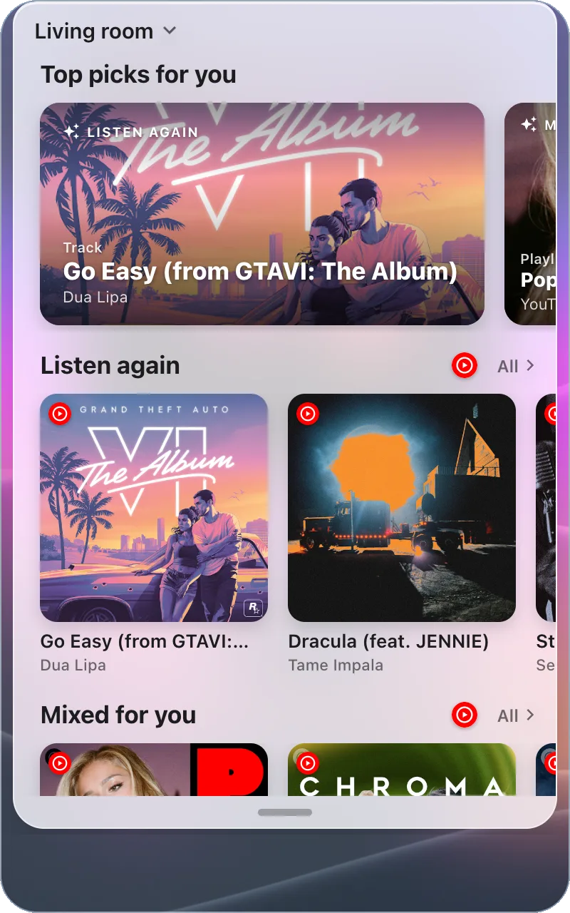

> **⚠ The token is readable.** It's stored in the dashboard's configuration in plain text, and the browser sends it to Music Assistant itself. Anyone who can open the dashboard's settings – or read the network traffic of a dashboard on plain `http` – can read it and control your Music Assistant with it. Fill it in only if that's fine with you, on a network you trust. Without it the card works all the same – only without the rows of Music Assistant's home and the playlists' tracks. (This is on purpose: it saves installing an integration just for the card.)

The browser talks to Music Assistant directly, so it must reach that address – and a dashboard opened over `https` can't reach Music Assistant on plain `http`.

## Layouts

One card, laid out for where it is – a tablet's pop-up, a phone, a corner of a dashboard.

**A tablet: the player and its library side by side** – two cards (`show: player` and `show: library`), see [below](#a-player-and-its-library-side-by-side):


**A phone** – one card (`show: all`), the library a sheet over the player from its handle; `fill_height: true` stretches it down to the dock:

| | |
| --- | --- |
| 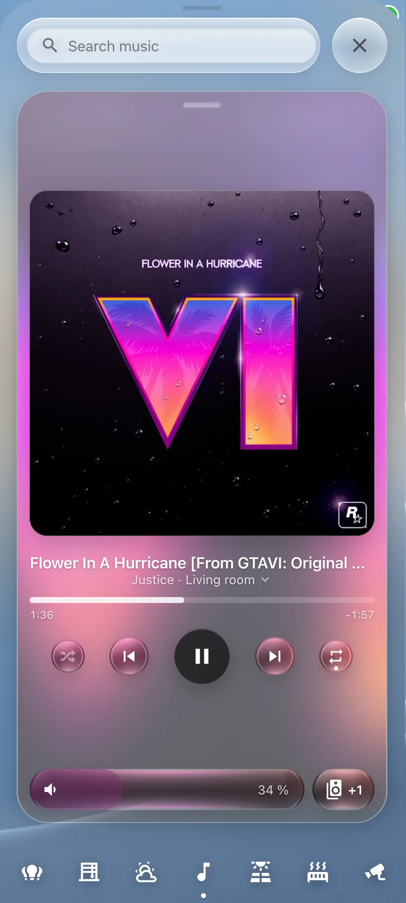 |  |

**The library over the card** (`show: all`, default) – open while nothing plays; while something does, the handle on top brings it up and it slides away again by itself:

| | |
| --- | --- |
| 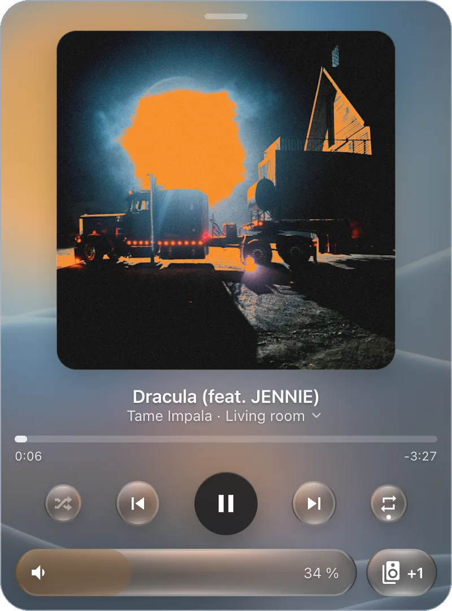 |  |

**Only the player** (`show: player`) or **only the library** (`show: library`) – each a card of its own:


**A tile** (`layout: tile`) and **a screensaver** (`layout: screen`) – [below](#tile).

## The cover's colours

Each cover lights the card its own way – the same card, four songs:

| | |
| --- | --- |
|  |  |
|  |  |

Wider, the cover moves to the left:

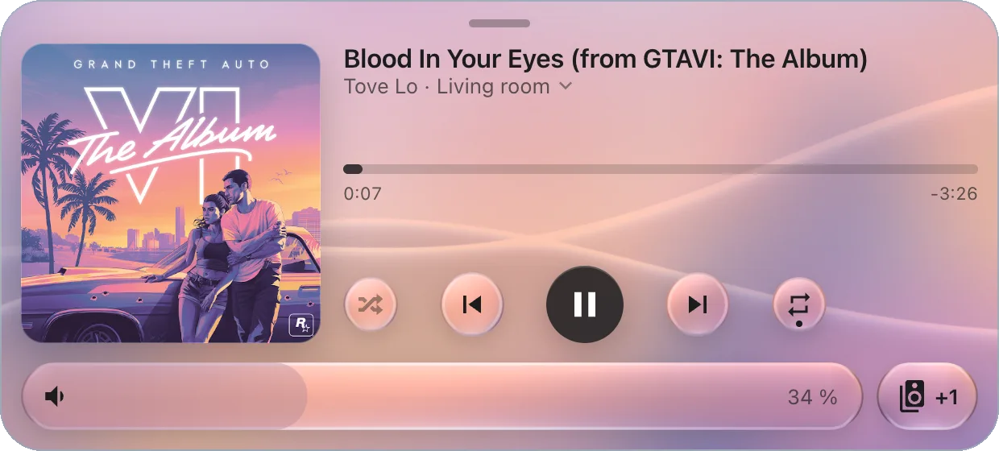

At night the cover dims and the glass turns dark:

| | |
| --- | --- |
| 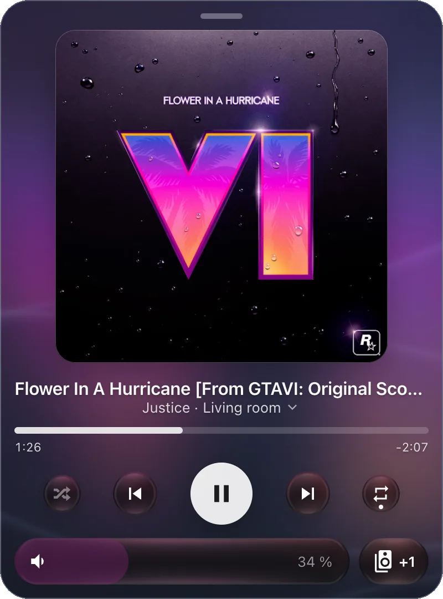 | 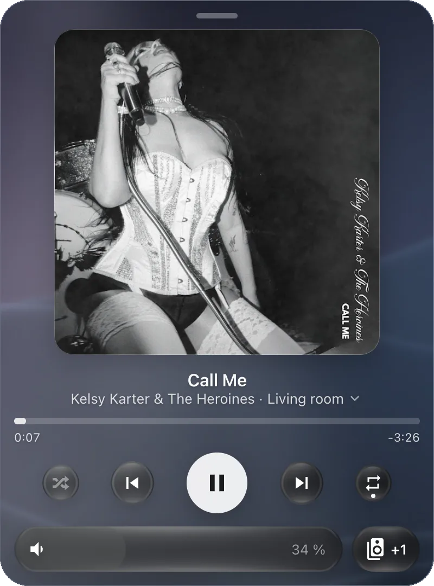 |

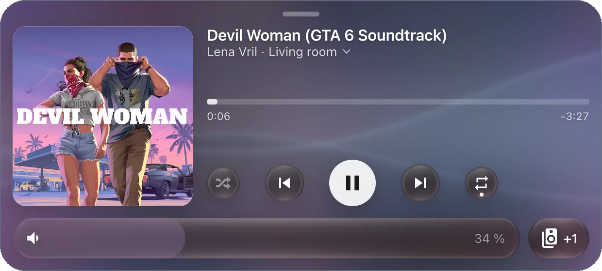

The text and the buttons' icons take the colour that reads on the cover – dark on a light one, white on a dark one. A pause dims the cover; the colours stay.

**Material with the cover** (`art_glass`) chooses the glass the cover lights, whatever the hour:

| `art_glass` | |
| --- | --- |
| *(not set)* | light liquid glass by day, dark at night; in a panel, as the panel |
| `liquid` | light liquid glass with the cover's colours, dark text |
| `dark-liquid` | dark liquid glass with the cover's colours, white text |

`art_background: false` leaves the cover out: the card is the plain glass of the dashboard.

## Controls

- **Play / pause** – the solid button in the middle. It shows what you pressed at once, while the player gets there (some, as Plex, take a few seconds).
- **Previous, next, shuffle, repeat** – when the player can (Home Assistant says it). Shuffle and repeat light up when on; repeat goes *all → one → off*. On a narrow card they step aside first.
- **The progress bar** – tap or drag to jump in the song.
- **The volume bar** – drag it; the speaker icon on it mutes, a second tap brings the volume back (a player that can't mute goes to 0 and back).
- A tap on the cover shows the **visualizer** in its place (below); a hold opens Home Assistant's more-info (`hold_action`). With `visualizer: false` the tap is `tap_action` again (more-info by default).

## Visualizer

A tap on the cover turns it into the cover's own colours moving to the music; another tap brings the cover back. Swipe it sideways for another look:

| Look | |
| --- | --- |
| Ring | blocks round the middle, stacked out by the sound – each the colour of the cover under it; a strong beat throws one out |
| Bars | bars up and down from a middle line, the lows in the middle – each a column of the cover |
| Orbit | the cover in a round that breathes with the sound, its light behind, dots of its colours in orbit |

The browser remembers it (on or off, which look) for every media card on it.

Home Assistant never hands the card the sound itself – a Sonos plays it, not the browser – so the visualizer plays its own: a beat, a snare, hi-hats and a melody, seeded by the song (the same song always moves the same way) and set by where in the song it is: it follows a seek, rests on a pause, starts quietly and fades out at the end. It is a plain canvas (no liquid glass, no WebGL): a fraction of a millisecond a frame, a few frames a second when paused, none when out of sight.

## Keyboard media keys

With `media_keys: true` the media keys of a computer's keyboard – play / pause, next, previous – play on the card's player (the one it shows, through its queue as its own buttons do), also with the browser minimised, Home Assistant in a tab behind or the card in a closed pop-up. The system's own controls show the song with its cover and work too: macOS' Control Center, Windows' media flyout.

A browser sends media keys only to a page that plays sound, so the tab plays a loop of silence (a speaker shows on it). Browsers let that start only after a first click or key on the page: after loading Home Assistant, click anywhere once. The keys go to whatever started playing last – Spotify or a YouTube tab started after takes them over. With more than one such card, the keys go to the one touched last. Chrome, Edge and Firefox; Safari is stricter about sound and may not.

## More players

`entity` and `entities` are the players the card switches between:

- it shows the one **playing**; paused, it stays on it (play is at hand) and moves to another only when that one starts playing later;
- with more than one, **a tap on the player's name** (▾) lists them – each with its cover and what it plays, bars moving by the one that plays. The one you pick stays until another starts playing after it.


## Speakers – grouping

The button at the right of the volume bar lists the speakers to group with the one shown: tick one and it plays the same, untick it and it leaves. Each has its own volume bar; the button shows how many play along (`+1`).

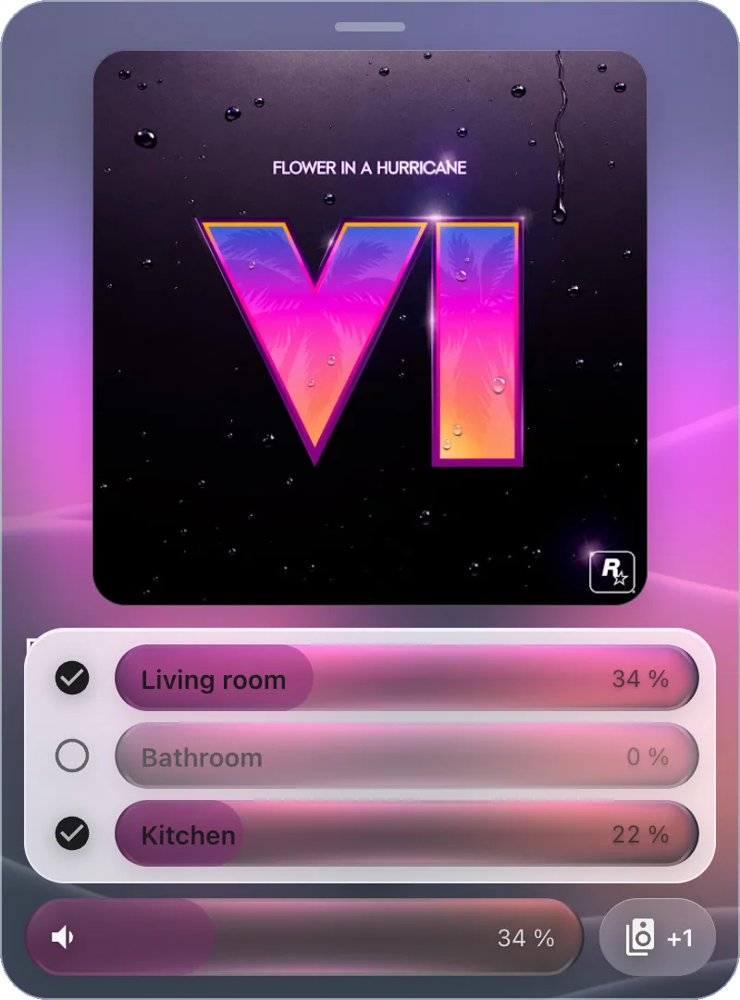

The list offers only speakers that can join the one shown: those of **the same integration** that can group – Sonos with Sonos, Music Assistant's players with each other (a TV or a radio gets no tick). It lists all of them in the home, not only the card's `entities`. `speakers: false` leaves the button out.

## At rest – the library

With nothing playing the card opens its **library**: the rows of what the player can browse, as a music app shows them – what you played, what's new, playlists, favourites, radio, albums, artists. Artists are round, albums and playlists square; one without a cover gets a coloured tile with its icon.

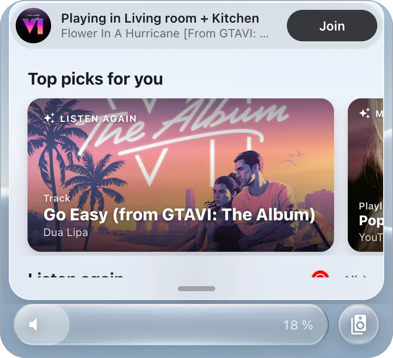

- **Swipe a row** sideways, the library up and down (with a mouse: drag). On a tablet it never moves the Bubble Card pop-up it's in.
- **All ›** opens the whole row; an **artist** opens their albums.
- **A tap on a cover** plays it: a spinner on the cover and on play until the player plays it, and the card stays on that player meanwhile.
- While something plays, the library slides up to a **handle** at the top of the card – tap it to bring it back. It slides away again after `library_close` seconds without a touch (default 8, `0` = it stays).

What the rows are depends on the player – Home Assistant's media browser:

| Player | The library |
| --- | --- |
| **Music Assistant** | Its library (with YouTube Music in it: yours too); with [the token](#music-assistants-address-and-token-optional) its home's rows first |
| **Sonos** | Its favourites (*My Sonos*): playlists and albums from all its services – YouTube Music, Spotify… |
| **Plex** | Recently played and added, playlists, the music library |
| **YouTube Music** (integration) | Your home: mixes, new releases, playlists for you… – see [YouTube Music](#youtube-music) |
| a player that can't browse | its sources (radio stations, inputs left out) |

Your own covers come first (`favorites`), in rows of their own by `row`:

```yaml
favorites:
  - name: Morning radio
    image: /local/covers/radio.jpg
    row: Radio
    media_content_id: http://radio.example/stream.mp3
    media_content_type: music
  - name: Kitchen jazz
    source: Jazz FM          # or a source of the player
```

`library_sections` picks the rows, in its order, by their titles. `library: false` turns the library off.

## Tile

`layout: tile` – one pill: the cover, what plays and play / pause. **The pill itself is the volume**: drag along it.

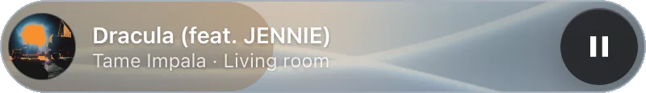

## Screen – a screensaver

`layout: screen` – the player as the whole view, for the effect: the cover big over itself blurred and slowly drifting, the song in large type, the time and the date (`clock: false` leaves them out). Nothing playing: a large clock. Left untouched for 5 seconds, the buttons and the cursor fade out; the song, its bar and the time stay. A touch brings them back.

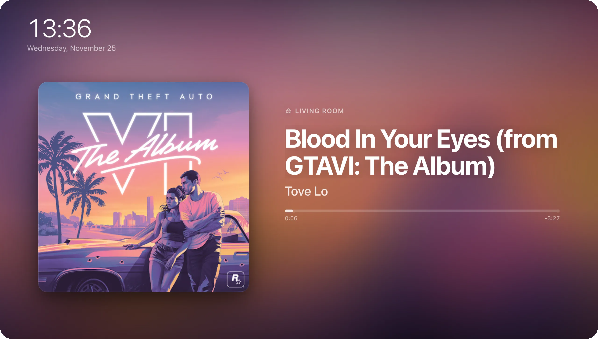

A touch – the buttons back, play / pause the largest:

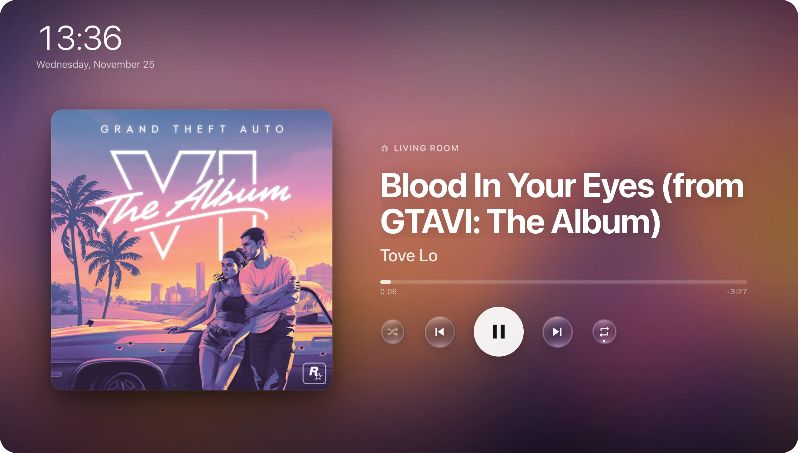

| | |
| --- | --- |
|  | 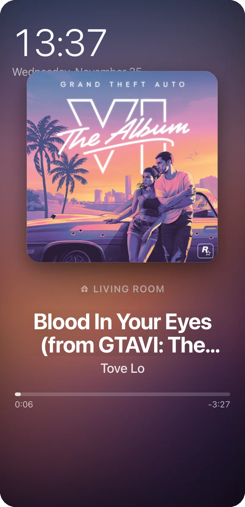 |

Put it alone on a dashboard of its own (a panel view). A kiosk app that shows a dashboard as its screensaver then shows what plays.

```yaml
type: custom:glass-media
entity: media_player.living_room
entities: [media_player.living_room, media_player.kitchen]   # it shows the one playing
layout: screen
```

## A player and its library side by side

A pop-up as the demo's **Music**: the player on the left on the dark glass of the side panel, the library on the right, a search in the header. Two cards with the same players: `show: player` and `show: library`.


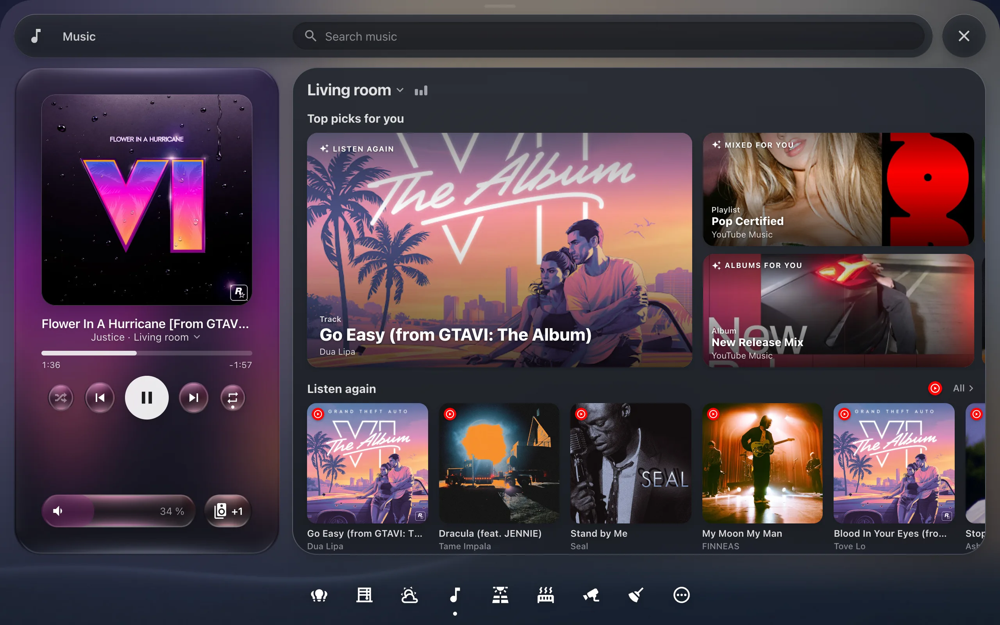

| `show` | |
| --- | --- |
| `all` (default) | the player with its library (the sheet) |
| `player` | the player alone – it fills its side: the cover and controls on top, the volume at the bottom |
| `library` | the library alone, always open – its player's name on top (▾ picks another) |

**The two cards are linked by themselves**: cards with the same players share the player picked – pick another on the left and the library on the right is that player's; a tap in the library plays on it.

In a panel the cover lights **the whole panel**, to its rounded edges – not a card inside it.

```yaml
type: custom:bubble-card
card_type: pop-up
hash: "#music"
show_header: false
width_desktop: 1280px
cards:
  - type: custom:glass-popup-header
    name: Music
    icon: mdi:music-note
    search: true                      # the search field – it searches the library below
    search_placeholder: Search music
    # the search field starts right above the library: the left side's width
    title_width: calc(max(340px, calc((100cqw - 22px) * 0.36 / 1.36)) - 20px)
  - type: custom:glass-panel
    glass: none
    layout: row
    gap: 16
    padding: 0
    align: stretch
    height: 624px
    cards:
      - type: custom:glass-panel
        role: sidebar                 # the side panel's (dark) glass
        padding: 22
        view_layout: { grow: 0, shrink: 0, basis: "max(340px, calc((100% - 22px) * 0.36 / 1.36))" }
        cards:
          - type: custom:glass-media
            entity: media_player.living_room
            entities: [media_player.kitchen, media_player.bathroom]
            show: player
      - type: custom:glass-media
        entity: media_player.living_room
        entities: [media_player.kitchen, media_player.bathroom]
        show: library
        view_layout: { grow: 1, basis: 0px }
```

On a phone one card with `show: all` does both: the library opens from its handle.


### Search

`search: true` on the [pop-up header](popup-header.md) puts a search field in it, linked to the library in the same pop-up (nothing to set). As you type the library turns into a grid:

- **In the library** – what matches in the rows already loaded, at once (no matter capitals or accents);
- **Search results** – once the typing pauses, what the player's own search finds: YouTube Music's whole catalogue, or any player Home Assistant can search (`media_player.search_media` – Music Assistant…).

✕, Esc or an empty field bring the rows back; closing the pop-up empties it.


> **In the web demo** the search finds only what's in the library already – there's no YouTube Music behind it.

## YouTube Music

**The way to go: YouTube Music in Music Assistant.** Add it in Music Assistant (Settings → Music providers → YouTube Music) and it's simply part of Music Assistant's library, search and home in the card – playing on any of Music Assistant's speakers, a Sonos too. Nothing to set in the card; with [the token](#music-assistants-address-and-token-optional) its mixes and playlists open with all their tracks.

**Without Music Assistant** – with the [YouTube Music Player](https://github.com/KoljaWindeler/ytube_music_player) integration (HACS) the card shows your YouTube Music – and plays it **on your speakers**, a Sonos too:

```yaml
type: custom:glass-media
entity: media_player.kitchen          # the speakers…
entities: [media_player.living_room, media_player.bathroom]
library_from: media_player.ytube_music_player   # …and YouTube Music's library for them
```

- The library is YouTube Music's (your home: mixes, new releases, playlists for you…), whichever speaker is picked; the search searches all of YouTube Music.
- A tap tells YouTube Music to play **on the speaker picked** (it switches its speaker to it) and plays it.
- The speaker shows what YouTube Music plays: the title, artist, cover and position come from YouTube Music (the speaker itself knows only the stream's address); **next, previous, pause, seek, shuffle and repeat go to YouTube Music** – it holds the queue. The volume is the speaker's.
- YouTube Music needn't be one of the card's players.

**Setting the integration up** – sign-in goes through your browser's headers (its OAuth no longer works):

1. On music.youtube.com, signed in, open the browser's developer tools → **Network**, filter `browse` and click e.g. Library.
2. Copy the `browse` request's **request headers** (Chrome: *Headers* → *Request Headers*, all of it).
3. Make the headers file with [ytmusicapi](https://ytmusicapi.readthedocs.io/en/stable/setup/browser.html) – pasted from the clipboard, as a terminal cuts long lines:
   ```bash
   pbpaste > headers.txt && uvx --from ytmusicapi ytmusicapi browser < headers.txt; rm headers.txt
   ```
4. Copy `browser.json` to `/config/.storage/header_ytube_music_player.json` (the integration's name in it) and reload the integration.

> If the playlists stay at *loading* and the log says `JSONDecodeError`, take `content-encoding` out of the headers file – Chrome adds it, and YouTube then refuses the requests.

The headers are your Google sign-in: keep the file to yourself. When they expire, the library stays empty again – make a new file.

> **It plays only when YouTube lets it.** The integration fetches each song's stream from YouTube and hands it to the speaker; when YouTube refuses (the log says `self decoded url return 403`), the speaker gets nothing it can play – a Sonos answers `UPnP Error 714: Illegal MIME-Type` – and the card's spinner runs out. The library and the search work all the same. That's the integration and YouTube, not the card.

**On a Sonos the sure way is Sonos itself** – it plays YouTube Music through its own service: heart a playlist in the Sonos app (*My Sonos*) and it's in the card's library for the Sonos speakers (leave `library_from` out). Only the ones you hearted, but they always play – as an automation playing a Sonos favourite does.

### Playlists and albums

**Hold a playlist or an album** (or right-click it) and it opens: its cover, name and a play button for the shown player, then its tracks. A tap on a track plays it – with [Music Assistant's token](#music-assistants-address-and-token-optional) on a Music Assistant player (or a speaker's twin) the playlist plays on from that track, else the track alone. A tap on the cover itself still plays it.

The list of players marks each one's kind after its name – Sonos, Chromecast, AirPlay, Sendspin… as Music Assistant names it, or Home Assistant's mark for a player that isn't Music Assistant's. With the token it's Music Assistant's own word; without it the card guesses from the device's maker.

## Sonos, Music Assistant, Plex

- **Sonos** – each speaker a player; grouping in the card; the library is its favourites.
- **Music Assistant** – its players group with each other (as far as their kind allows); its library and search in the card.
- **Plex** (Plexamp) – Home Assistant's Plex integration has no shuffle or repeat, so the card shows none. Played through Music Assistant (Plex as its music source) it has both.

## Options

<!-- options -->
| Option | Type | What it does |
| --- | --- | --- |
| `entity` | string | the player |
| `entities` | string[] | more players: the card shows the one playing (a tap on the name picks another) |
| `name` | string | Name |
| `layout` | "card" \| "tile" \| "screen" | card (default), tile – one pill; screen – the whole screen (a kiosk's screensaver) |
| `show` | "all" \| "player" \| "library" | all (default): the player with its library; player: the player alone; library: the library alone, as a card of its own (beside the player, as in a pop-up's two sides) |
| `speakers` | boolean | the button of the speakers to group with the one shown (default true) |
| `library` | boolean | show: all – the player's library (playlists, albums, artists in rows): open while nothing plays, a handle on top while it does (default true) |
| `library_close` | number | opened while something plays: down again after this many seconds without a touch (default 8; 0 = stays) |
| `library_layout` | "sheet" \| "below" | show: all – the library as a sheet over the player (default, its handle on top), or below it |
| `favorites` | Pick[] | your own covers, the first row of the library |
| `library_from` | string | the library of another player for the others (YouTube Music for a Sonos): a tap plays it through that player on the one picked |
| `library_sections` | string[] | which rows of the library, in this order (their titles); default: all, played and new first |
| `music_assistant_url` | string | Music Assistant's own address (`http://…:8095`) – with a token, the card talks to Music Assistant itself: its home's rows, every playlist's tracks, each player's kind (optional) |
| `music_assistant_token` | string | a token made in Music Assistant (Settings → profile → tokens) – stored in the dashboard in plain text: anyone who can read the dashboard's configuration can read it (optional, see the docs) |
| `media_keys` | boolean | the keyboard's media keys (play / pause, next, previous) play on this card's player – also with the window minimised or the card in a closed pop-up (default false) |
| `visualizer` | boolean | a tap on the cover shows a visualizer in its place – the cover's colours moving to the music (default true; false: the tap action) |
| `tap_action` | action | Tap |
| `hold_action` | action | Hold |

#### Look

Materials and colours of the card's parts – set them in the card's **Appearance** tab, or here.

| Option | Type | What it does |
| --- | --- | --- |
| `art_background` | boolean | Blurred cover behind the glass |
| `art_glass` | "liquid" \| "dark-liquid" | the glass the cover's colours light: liquid (light) or dark-liquid; default by day and night (in a panel: by the panel) |
| `fill_height` | boolean | the card as tall as the screen lets it: down to the dock (glass-dock, Bubble Card's buttons) |
| `controls_glass` | material | the buttons and bars: real liquid glass over the blurred art (default liquid-gl; dark-liquid-gl at night) |
| `controls_color` | string | Colour of the controls (a tint of its material). |
<!-- /options -->

---

[All cards](../README.md#the-cards) · [Pop-up header](popup-header.md) · [Look and feel](../appearance.md)
