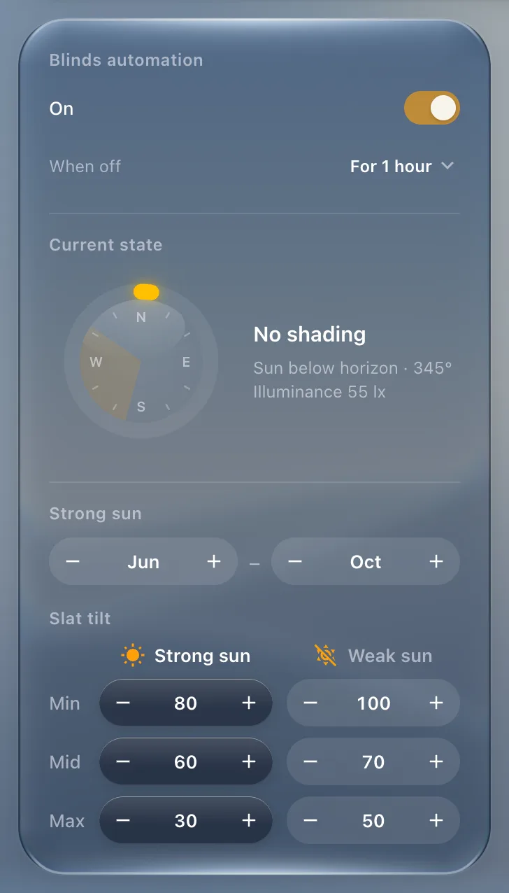

# Panel

`custom:glass-panel`

A glass frame that arranges other cards in a row, a column or a grid. The panel owns the glass (and the blur); glass cards inside are drawn flat on it, which keeps a full dashboard fast.



**Good for:** grouping cards – a room's controls, the side column, a grid of room cards.

## Quick start

```yaml
type: custom:glass-panel
layout: grid           # row | column | grid
columns: 3
gap: 14
padding: 20
title: Living room     # optional heading
icon: mdi:sofa
cards:
  - type: custom:glass-light
    lights: [light.living_room]
  - type: custom:glass-thermostat
    entity: climate.living_room
```

How each card inside takes its room (`view_layout: grow / basis / span…`) is explained in [Layout → Panels](../layout.md#panels).

## Tips

- `glass: none` – an invisible panel, just for arranging.
- `scroll: true` with `layout: row` – a strip you swipe sideways (room cards on a phone). `item_width` sets each card's width.
- `masonry: true` – a grid without gaps, each card as tall as its content.
- `role: sidebar` – the look's side-column material (Apple Home's dark sidebar) even when nested.
- `tile_glass` / `control_glass` – the material of the cards and of the buttons inside.

## Options

<!-- options -->
| Option | Type | What it does |
| --- | --- | --- |
| `cards` **required** | BaseCardConfig[] | Cards (YAML) |
| `equal_rows` | boolean \| "true" \| "false" | Grid: every card the same height (default on tablets / computers) or each row as tall as it needs (phones). |
| `masonry` | boolean | Grid: each card only as tall as its content, packed into the columns without gaps (left to right, like a wall). |
| `masonry_fill` | boolean | masonry: the cards share out the height the panel has beyond its tallest column |
| `min_column_width` | number | Grid: as many columns as fit at this width (px) instead of a fixed `columns` – e.g. two on a wide phone, one on a narrow one. |
| `layout` | "row" \| "column" \| "grid" | Layout |
| `wrap` | boolean | Wrap rows |
| `scroll` | boolean | Row: a strip that scrolls sideways (swipe), the cards snapping to its start – e.g. rooms on a phone. |
| `item_width` | number \| string | scroll: each card's width (px or CSS); its height is the panel's `height` / the row's |
| `columns` | number | Columns |
| `rows` | number | Rows |
| `column_widths` | string \| (string \| number)[] | grid: own column widths, e.g. "2 1" (shares), "60% 40%", "300px 1" – the number of columns follows. |
| `row_heights` | string \| (string \| number)[] | grid: own row heights, as column_widths. |
| `gap` | number | Gap (px) |
| `padding` | number \| string | Margin |
| `align` | string | Alignment |
| `justify` | string | Main axis distribution |
| `title` | string | Title |
| `icon` | string | Icon |
| `height` | string | Height |
| `role` | "panel" \| "sidebar" | A top-level surface wherever the panel sits (e.g. inside a pop-up layout): `panel` takes the look's panel glass, `sidebar` the look's side-column material (Apple Home: dark liquid). |
| `bar` | boolean | The material of the liquid glass bars (thermostat, light, period bar) instead of a tile. |

#### Look

Materials and colours of the card's parts – set them in the card's **Appearance** tab, or here.

| Option | Type | What it does |
| --- | --- | --- |
| `tile_glass` | GlassMode | Material of cards inside panels |
| `control_glass` | GlassMode | Material of the items inside |
<!-- /options -->

---

[All cards](../README.md#the-cards) · [Look and feel](../appearance.md) · [Actions and conditions](../actions-and-conditions.md)
