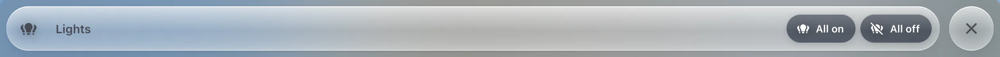

# Pop-up header

`custom:glass-popup-header`

A glass header for a pop-up of [Bubble Card](https://github.com/Clooos/Bubble-Card) – the pop-up itself is Bubble Card's, made by [Clooos](https://github.com/Clooos); this card only gives it a glass header, for a pop-up whose own header is hidden: the icon and name on a bar of liquid glass, any cards in the middle (a period bar…), buttons on the right and a round close button.



**Good for:** pop-ups that should look like the rest of the dashboard.

## Quick start

```yaml
type: custom:glass-popup-header
name: Energy
icon: mdi:solar-power-variant
buttons:
  - name: All lights on
    icon: mdi:lightbulb-group
    tap_action:
      action: perform-action
      perform_action: light.turn_on
      target: { entity_id: all }
    confirm: true          # ✕ / ✓ first
cards:
  - type: custom:glass-period-bar
```

Needs [Bubble Card](https://github.com/Clooos/Bubble-Card) by [Clooos](https://github.com/Clooos). Set the pop-up's own header off (`show_header: false`) and put this card first.


## Options

<!-- options -->
| Option | Type | What it does |
| --- | --- | --- |
| `name` | string | Name |
| `icon` | string | Icon |
| `cards` | BaseCardConfig[] | Cards (YAML) |
| `title_width` | string | Where the cards start – e.g. 352px or 30cqw – in line with the content under a side panel |
| `close` | boolean | Close button |
| `buttons` | { name?: string; icon?: string; tap_action?: action; active?: condition; align?: "start" \| "end"; confirm?: boolean }[] | Buttons (name, icon, tap_action) |

#### Look

Materials and colours of the card's parts – set them in the card's **Appearance** tab, or here.

| Option | Type | What it does |
| --- | --- | --- |
| `bar_glass` | material | Material of the bar – see [Materials](../appearance.md#materials). |
| `bar_color` | string | Colour of the bar (a tint of its material). |
| `icon_glass` | material | Material of the icon – see [Materials](../appearance.md#materials). |
| `icon_background` | string |  |
| `buttons_glass` | material | Material of the buttons – see [Materials](../appearance.md#materials). |
| `buttons_color` | string | Colour of the buttons (a tint of its material). |
| `off_glass` | material | Material of the off – see [Materials](../appearance.md#materials). |
| `off_color` | string | Colour of the off (a tint of its material). |
| `close_glass` | material | Material of the close – see [Materials](../appearance.md#materials). |
| `close_color` | string | Colour of the close (a tint of its material). |
<!-- /options -->

---

[All cards](../README.md#the-cards) · [Look and feel](../appearance.md) · [Actions and conditions](../actions-and-conditions.md)
