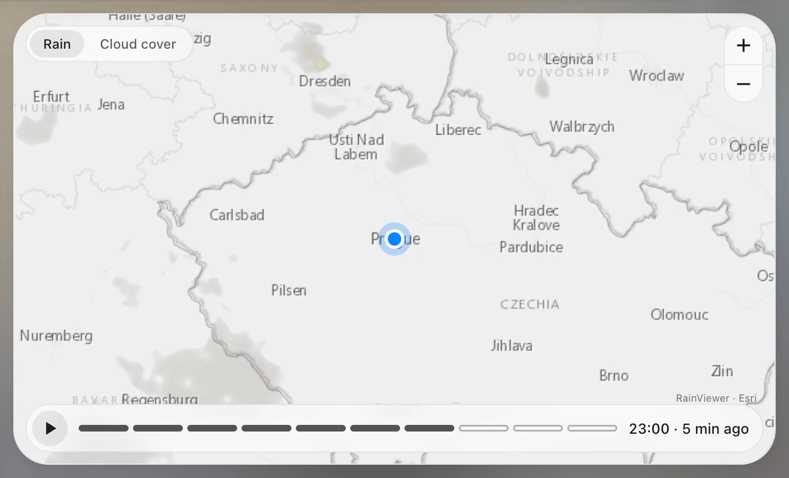

# Radar

`custom:glass-radar`

Real satellite clouds and the rain radar over your home, animated over the last hour – and a few hours of rain forecast. Tabs switch between the satellite picture, clouds and rain; zoom and drag like a map.



**Good for:** a weather page, next to the forecast.

## Quick start

```yaml
type: custom:glass-radar
zoom: 6                    # 5–10
frames: 7                  # 10-minute steps in the loop
forecast: 3                # + hours of rain forecast
style: rain                # satellite | clouds | rain
styles: [rain, clouds, satellite]   # tabs on the map
height: fill               # the room the panel gives it; or px
```

No account or API key: the satellite is EUMETSAT (Europe, Africa), rain is RainViewer (worldwide) or the German DWD (`radar_provider: dwd`), the map Esri. Nothing loads before the card is on screen, and the loop stops while it's hidden.

## Tips

- `autoplay: true` – play the loop right away (default: still on the newest frame, ▶ plays).
- `latitude` / `longitude` – centre somewhere else than home.

## Options

<!-- options -->
| Option | Type | What it does |
| --- | --- | --- |
| `latitude` | number | Latitude |
| `longitude` | number | Longitude |
| `zoom` | number | Map zoom |
| `frames` | number | Frames (10 min each) |
| `forecast` | number | Hours of precipitation forecast after the radar frames (DWD ICON-EU), 0–12; default 0. |
| `height` | number \| string | Height |
| `aspect_ratio` | number \| string |  |
| `satellite` | boolean | Satellite clouds |
| `satellite_layer` | string |  |
| `style` | RadarStyle | Style |
| `style_switch` | boolean | Switch on the map between the two styles (default true). |
| `satellite_delay` | number | Minutes the satellite lags behind real time (EUMETSAT publishes ~30 min late). |
| `radar` | boolean | Precipitation radar |
| `radar_opacity` | number | Radar opacity |
| `labels` | boolean | Place names |
| `borders` | boolean | Country borders on the drawn maps (rain / clouds). |
| `marker` | boolean | Home marker |
| `autoplay` | boolean | Play automatically |
| `speed` | number | Frame time |
| `title` | string | Title |
| `radar_provider` | "rainviewer" \| "dwd" |  |
| `map_provider` | "esri" \| "carto" \| "osm" |  |
| `show_forecast` | boolean | Show the forecast |

#### Look

Materials and colours of the card's parts – set them in the card's **Appearance** tab, or here.

| Option | Type | What it does |
| --- | --- | --- |
| `radar_color` | number | Colour of the radar (a tint of its material). |
| `controls_glass` | material | Material of the controls – see [Materials](../appearance.md#materials). |
| `controls_color` | string | Colour of the controls (a tint of its material). |
| `play_glass` | material | Material of the play – see [Materials](../appearance.md#materials). |
| `play_color` | string | Colour of the play (a tint of its material). |
| `tab_glass` | material | Material of the picked tab – see [Materials](../appearance.md#materials). |
| `tab_color` | string | Colour of the picked tab (a tint of its material). |
| `timeline_color` | string | Colour of the timeline (a tint of its material). |
| `marker_color` | string | Colour of the marker (a tint of its material). |
<!-- /options -->

---

[All cards](../README.md#the-cards) · [Look and feel](../appearance.md) · [Actions and conditions](../actions-and-conditions.md)
