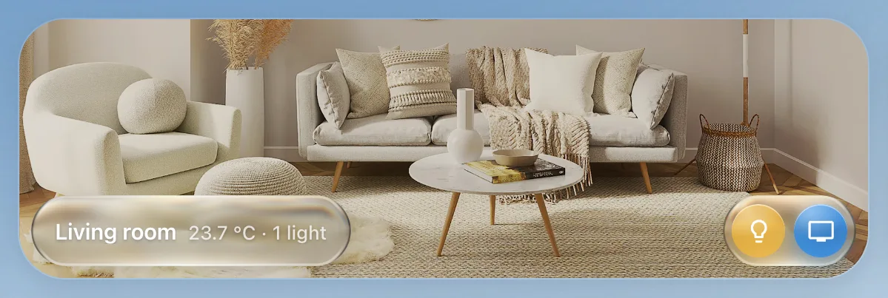

# Room

`custom:glass-room-card`

A room as a tile: its icon or a photo, its name, a small status (“22.1 ° · 2 lights · TV”) and round buttons for its devices. The photo can stay grey while everything in the room is off and turn to colour as soon as something is on.



**Good for:** the main grid of rooms; a swipeable strip of rooms on a phone.

## Quick start

```yaml
type: custom:glass-room-card
name: Living room
icon: mdi:sofa
layout: image-full                 # the photo edge to edge, buttons on a glass bar
image: /local/rooms/living-room.jpg
image_color: active                # grey until something here is on
info:
  - entity: sensor.living_room_temperature
    precision: 1
entities:
  - entity: light.living_room
    icon: mdi:lightbulb-outline
  - entity: media_player.living_room_tv
    icon: mdi:television
    name: TV
  - entity: cover.living_room_blind
    icon: mdi:blinds-horizontal
    active_states: [closed]          # "on" while closed
    state_icons:
      closed: mdi:blinds-horizontal-closed
```

### Layouts

| `layout` | |
| --- | --- |
| `stacked` (default) | the icon above the buttons |
| `image-left` / `image-right` / `image-bottom` | a photo beside or under the buttons |
| `image-background` | the photo fills the tile, buttons in a row (phones) |
| `image-full` | the photo edge to edge, name, status and buttons on a glass bar (`bar: split` – on capsules of their own) |
| `compact` | a low strip: a thumbnail, the name, the status, the buttons |

### Buttons

Every button is an entity with its icon. It lights in `active_color` while on and toggles on a
tap. Make it do more with an action – e.g. a [menu](../actions-and-conditions.md#menus) with the
blind's positions, or `tap_action: { action: navigate, navigation_path: "#lights" }` to open a pop-up.
`rules` colour, animate or badge a button by state (a server that is *unhealthy* pulses orange).

## Tips

- A washing machine button: `washer: true` – lit while it runs, like the [appliance](appliance.md) card.
- `image_entities` – which entities colour the photo (default: the card's buttons); `image_on` – any condition of your own.
- `contextual:` – buttons that show only while something is on (a game console while it's running).

## Options

<!-- options -->
| Option | Type | What it does |
| --- | --- | --- |
| `name` | string | Name |
| `icon` | string | Icon |
| `show_name` | boolean | Show the name |
| `show_icon` | boolean | Classic layouts: the room icon (default on). |
| `entities` | RoomEntityConfig[] | Entities |
| `max_entities` | number | Max. entities |
| `columns` | number | Columns |
| `rows` | number | Rows |
| `layout` | "stacked" \| "image-bottom" \| "image-left" \| "image-right" \| "image-background" \| "image-full" \| "compact" | Layout |
| `status` | "auto" \| "info" \| "none" \| false | image-full / compact: the line under the name – `info` plus what is on (auto), `info` only, or none. |
| `status_below` | boolean | image-full: the status on a second line under the name (narrow tiles, phones) |
| `buttons` | "bar" \| "top-center" \| "top-end" | image-full: the buttons' capsule on the photo's top edge instead of in the bar (narrow tiles, phones) |
| `bar` | "full" \| "split" | image-full / compact: one glass bar across the tile with name, status and buttons (default), or split – a capsule as wide as the name and status, the buttons on a capsule of their own (wide tiles). |
| `button_gap` | number | Button gap (empty = even) |
| `image` | string | Image – URL (e.g. /local/rooms/kitchen.jpg) or an image. / camera. entity |
| `image_position` | string | Image position |
| `image_opacity` | number | Opacity |
| `image_fade` | number | How far the photo fades out, 0–100 (default 50). |
| `image_on` | condition | Full image only when (condition) |
| `image_entities` | string[] | On means – Empty = any of the buttons |
| `button_align` | "spread" \| "start" \| "center" \| "end" | image-background: spread over the full width (default), or packed left / centred / right. |
| `info` | (ValueOptions & { icon?: string; visible?: condition })[] | Corner values (YAML) |
| `contextual` | RoomEntityConfig[] | image-full / compact: up to two buttons left of the others, only while they are on (or `visible`) – music, a player. |
| `rules` | Rule[] | Rules (YAML) |
| `animation` | string | Animation |
| `tap_action` | action | Tap |
| `hold_action` | action | Hold |
| `double_tap_action` | action | Double tap |

#### Look

Materials and colours of the card's parts – set them in the card's **Appearance** tab, or here.

| Option | Type | What it does |
| --- | --- | --- |
| `bar_glass` | "liquid" \| "frosted" \| "solid" \| "none" | image-full / compact: the bar's material – liquid glass (default), frosted, or none. |
| `bar_tint` | { color: number[] \| string; strength?: number } | image-full / compact: the bar's colour, as glass_tint: { color, strength }. |
| `active_color` | string | One colour for every button that is on (unless the button sets its own) – e.g. amber for a calm grid. |
| `image_color` | "always" \| "active" | Photo in colour |
| `button_size` | number | Button size (px, empty = automatic) |
<!-- /options -->

---

[All cards](../README.md#the-cards) · [Look and feel](../appearance.md) · [Actions and conditions](../actions-and-conditions.md)
