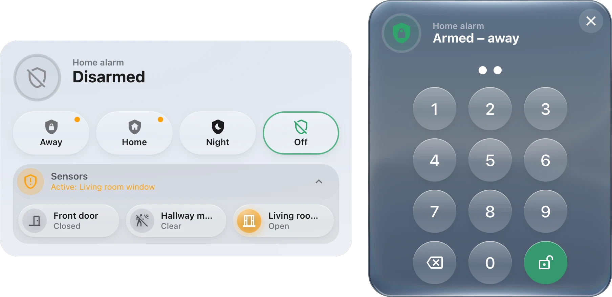
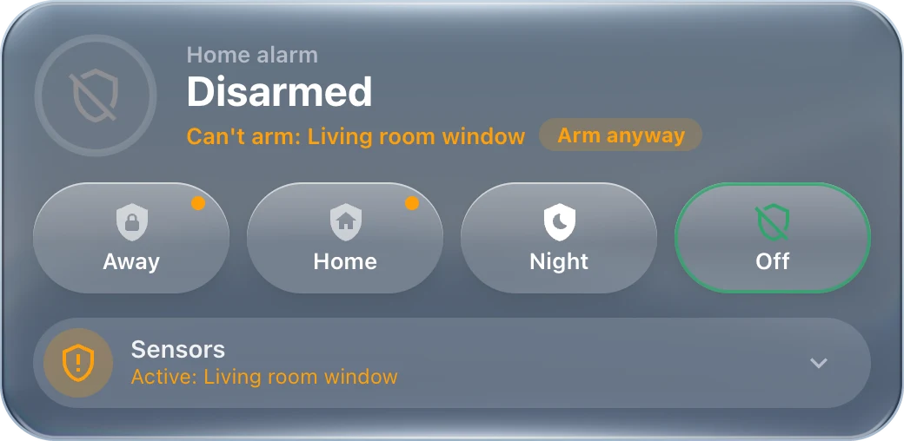
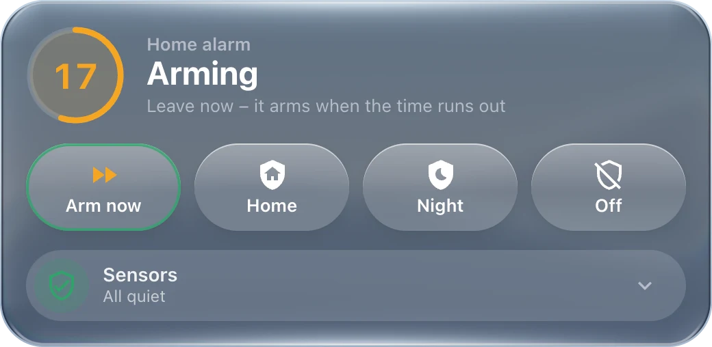
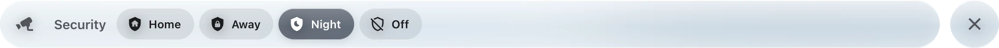
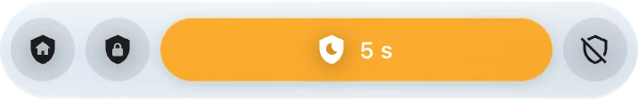
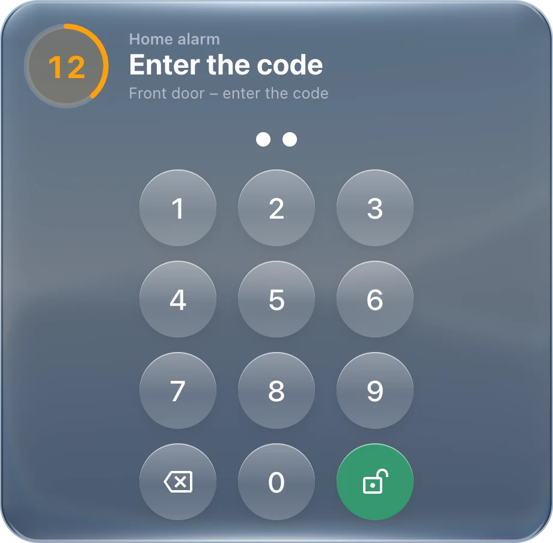

# Security

`custom:glass-security`

An alarm panel: the alarm's state, buttons to arm it, a countdown and a keypad. It can also be just the arm buttons in a pop-up's header, or a pop-up that appears on every screen when someone comes in.



## What it needs

- **An alarm:** any `alarm_control_panel` entity.
- **[Alarmo](https://github.com/nielsfaber/alarmo)** (optional, from the Marketplace). With Alarmo the card also shows:
  - the exact countdown;
  - which modes can't be armed because something is open;
  - which sensor is in the way, with a button to arm without it;
  - a wrong code.
- **[Bubble Card](https://github.com/Clooos/Bubble-Card)** (from the Marketplace), only for the pop-ups.

## Add the card

In Glass Studio: **+** → **Security** → pick the alarm. Or in YAML:

```yaml
type: custom:glass-security
entity: alarm_control_panel.alarmo
```

## Using it

- **To arm**, tap a mode: Away, Home or Night. The mode in force is outlined.
- **While it arms**, the circle counts down the time to leave. The mode's button turns into **Arm now**, which skips the rest.
- **To disarm**, tap **Off**. A keypad opens over the screen. Type the code and tap the green lock.
- **When something is open**, a mode that can't be armed has an orange dot. If you tap it anyway, the line under the state says what's open and offers **Arm anyway**.

The card keeps its size in every state. Messages, such as a wrong code, show in the line under the state. On a narrow card, such as two side by side on a phone, the mode buttons show only their icons.





The keypad opens only when an action needs the code: Off, another mode if the alarm wants a code for it, or someone coming in. By default it opens over the screen, as in the picture at the top. Close it with the cross or a tap outside. Other settings:

- `keypad_popup: "#alarm-keypad"` opens it in a pop-up of its own instead (see below);
- `keypad: auto` shows it in the card whenever a code is needed;
- `keypad: always` keeps it in the card;
- `keypad: never` hides it.

The card passes the code to Home Assistant and doesn't keep it.

## Sensors

At the bottom, **Sensors** says whether everything is quiet or which sensor is active: an open door or window, motion, vibration. Tap it to see every sensor with its state and the modes it guards, as in the picture at the top.

With Alarmo the sensors come from Alarmo. For another alarm, list them under `sensors:`.

There are two other looks:

- `drawer_style: bar` gives a bar with a round button;
- `sensor_items: pills` shows the sensors as pills.

## In a pop-up's header

`layout: header` shows only the mode buttons and **Off**, as pills for a pop-up's header. The one in force is dark. While the alarm arms, it shows the seconds left instead of its name. If the names don't fit, the buttons that aren't in force drop theirs first.



```yaml
type: custom:glass-popup-header
name: Security
icon: mdi:cctv
cards:
  - type: custom:glass-security
    entity: alarm_control_panel.alarmo
    layout: header
    modes: [home, away, night]
```

On a phone, add `align: stretch`. The buttons then fill the row, and if the names don't fit, only the active button keeps its name.



## The keypad in a pop-up of its own

By default the keypad opens over the screen. To open it in a pop-up of its own instead, set `keypad_popup` to that pop-up's #hash. This works for the card and for the header. Then put a card with `layout: keypad` in that pop-up:

```yaml
# the card or the header
- type: custom:glass-security
  entity: alarm_control_panel.alarmo
  keypad_popup: "#alarm-keypad"

# the pop-up
type: custom:bubble-card
card_type: pop-up
hash: "#alarm-keypad"
show_header: false
cards:
  - type: custom:glass-security
    entity: alarm_control_panel.alarmo
    layout: keypad
    glass: home
```

## When someone comes in

This pop-up opens by itself while the alarm waits for the code or goes off. It shows on every screen with the dashboard open. Once the alarm is disarmed it closes.

```yaml
type: custom:bubble-card
card_type: pop-up
hash: "#alarm"
show_header: false
trigger:
  - condition: state
    entity: alarm_control_panel.alarmo
    state: [pending, triggered]
cards:
  - type: custom:glass-security
    entity: alarm_control_panel.alarmo
    glass: home
```

Put the pop-up in the dashboard's `overlay`, or in the dashboard your pop-ups come from. Among a panel's cards it would hide the panel. With `glass: home` the card stays readable over any wallpaper.



## A physical keypad

A USB or Bluetooth keypad works without any setup. Type the code and press Enter, while the card or its pop-up is on screen. A Zigbee keypad talks to the alarm directly, and the card follows.

## Set up in Alarmo

The card doesn't set any of these times or rules. Alarmo does, for each mode and each sensor:

- **Exit delay:** the time to leave after arming.
- **Entry delay:** the time to type the code after coming in.
- **Which sensors** each mode watches. For example, motion only in Away.
- **Use entry delay** on a sensor: it starts the countdown. Without it the alarm goes off at once, which suits a window.
- **Always on**, for smoke or water.
- **Actions:** what switches on when the alarm goes off, such as a siren or a script.

## Options

<!-- options -->
| Option | Type | What it does |
| --- | --- | --- |
| `entity` **required** | string | the alarm: an alarm_control_panel entity (Alarmo's, or any other) |
| `name` | string | the name shown (default: the entity's name) |
| `modes` | ArmMode[] | arm buttons: away \| home \| night \| vacation \| custom_bypass (default: the modes the alarm supports) |
| `keypad` | "ask" \| "auto" \| "always" \| "never" | the keypad: ask – when an action needs the code (a tap on Off or a mode), and while the alarm waits for it or rings (default); auto – whenever a code is needed; always; never |
| `keyboard` | boolean | a physical keypad or keyboard types into the card (default on) |
| `close_popup` | boolean | in a Bubble Card pop-up: close it once the alarm is disarmed or armed (default on) |
| `show_sensors` | boolean | the sensors that are open, triggered it or are bypassed (default on) |
| `sensors` | (string \| { entity: string; name?: string; icon?: string })[] | the drawer's sensors: entities, or { entity, name, icon } (default: Alarmo's sensors of this alarm) |
| `drawer` | boolean | the sensors in a drawer under a bar that says what's open (default on, when there are sensors) |
| `drawer_style` | "pill" \| "bar" | the drawer's bar: pill – a pill with the shield, the summary and an arrow (default); bar – a bar with a round button |
| `sensor_items` | "list" \| "pills" | the sensors in the drawer: list – a row each with its state and modes (default); pills – a pill each |
| `layout` | "card" \| "header" \| "keypad" | card – the whole panel (default); header – only the mode buttons, for a pop-up's header; keypad – only the state and the keypad, for a pop-up of its own |
| `keypad_popup` | string | open the keypad in this Bubble Card pop-up (its #hash) instead of over the screen – a pop-up with a glass-security card in it (layout: keypad) |
| `labels` | boolean | the header version: the buttons' names next to their icons (default on; off – round icons, e.g. on a phone) |
| `align` | "start" \| "end" \| "stretch" | the header version: the buttons at the start of the space they get (default) or at its end |

#### Look

Materials and colours of the card's parts – set them in the card's **Appearance** tab, or here.

| Option | Type | What it does |
| --- | --- | --- |
| `bar_glass` | material | material of the bar: the state, the shield that disarms, the modes |
| `bar_color` | string | Colour of the bar (a tint of its material). |
| `tray_glass` | material | material of the drawer under it |
| `tray_color` | string | Colour of the drawer under a bar (a tint of its material). |
| `sensors_glass` | material | material of the sensors' pills in the drawer (sensor_items: pills) |
| `sensors_color` | string | Colour of the sensors (a tint of its material). |
| `buttons_glass` | material | material of the mode buttons (the header version: the ones not in force) |
| `buttons_color` | string | Colour of the buttons (a tint of its material). |
| `active_glass` | material | the header version: material of the button in force (default: dark) |
| `active_color` | string | Color when on |
| `keys_glass` | material | material of the keypad's keys (and the text field of a text code) |
| `keys_color` | string | Colour of the keys (a tint of its material). |
| `actions_glass` | material | material of the round button (the countdown, the keypad) and "Arm anyway" |
| `actions_color` | string | Colour of the actions (a tint of its material). |
| `message_glass` | material | material of the message: a wrong code, why it couldn't arm |
| `message_color` | string | Colour of the message (a tint of its material). |
<!-- /options -->
