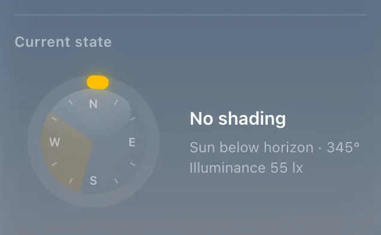

# Sun and shading

`custom:glass-sun-shading`

The sun over a compass with your windows' band – where it shines into the room – the light outside as a ring, and what your shading automation decided.



**Good for:** the side of a blinds page, with the automation switch and the value grid.

## Quick start

```yaml
type: custom:glass-sun-shading
sun: sun.sun
light: sensor.outdoor_illuminance
shading: sensor.blinds_shading_level      # optional: open / min / mid / max
azimuth_from: 195                         # where the sun shines in (° – 90 E, 180 S, 270 W)
azimuth_to: 305
horizon: 4                                # ° – below this the sun is behind the hills
```

See [Blinds that follow the sun](../automation-cards.md#sun-and-shading) for the sensors behind it.


## Options

<!-- options -->
| Option | Type | What it does |
| --- | --- | --- |
| `sun` | string | Sun |
| `light` | string | Light outside (lx) |
| `shading` | string | Shading decision – A sensor: open / min / mid / max |
| `target_tilt` | string | Target tilt |
| `azimuth_from` | number | From (°) |
| `azimuth_to` | number | To (°) |
| `azimuth_high_from` | number | From (°) |
| `azimuth_high_to` | number | To (°) |
| `azimuth_high_above` | number | Above (° of height) |
| `horizon` | number | Horizon (°) – Roofs or a hill: below this height the sun counts as set |
| `show_compass` | boolean | Compass |
| `show_details` | boolean | Text beside it |
| `size` | number | Compass size |
| `layout` | "side" \| "below" | Layout |
| `labels` | map of string | Place names |
| `thresholds_attribute` | string |  |
| `sun_style` | "icon" \| "dot" | icon: the realistic sun of the weather icons · dot: a plain dot (sun_color) |
| `show_letters` | boolean | Cardinal points (N E S W) |
| `show_ticks` | boolean | Ticks |
| `ring_width` | number | the light ring's width (of 100 – the compass's own scale) |
| `title` | string | Title – Empty = Current state |
| `show_title` | boolean | false: no title line |

#### Look

Materials and colours of the card's parts – set them in the card's **Appearance** tab, or here.

| Option | Type | What it does |
| --- | --- | --- |
| `band_color` | string | the shading azimuth on the compass (and "on the windows"); default orange |
| `light_color` | string | the light ring; default amber |
| `compass_glass` | "watch" \| material | the compass's face: watch (glass face, glare – default) or a material (none: only its rim) |
| `sun_color` | string | Colour of the sun (a tint of its material). |
<!-- /options -->

---

[All cards](../README.md#the-cards) · [Look and feel](../appearance.md) · [Actions and conditions](../actions-and-conditions.md)
