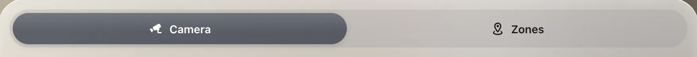

# Tabs

`custom:glass-tabs`

A segmented switch – Sun · Rain · Wind – that picks which cards of a panel show. The cards listen with a `visibility` condition, so you can switch any cards, not just glass ones.



**Good for:** several views of one panel: cleaning vs. mowing, today vs. week, cameras vs. map.

## Quick start

```yaml
type: custom:glass-panel
cards:
  - type: custom:glass-tabs
    group: garden
    default: map
    tabs:
      - { id: map, name: Zones, icon: mdi:map-marker-radius-outline }
      - { id: camera, name: Camera, icon: mdi:cctv }
  - type: custom:glass-room-map
    entity: lawn_mower.garden_mower
    visibility:
      - { condition: select, group: garden, id: map }
  - type: picture-entity
    entity: camera.garden
    visibility:
      - { condition: select, group: garden, id: camera }
```

## Tips

- The picked tab is remembered per browser tab, not stored in Home Assistant.
- A [dock](dock.md) with `group:` does the same for whole pages of a dashboard.

## Options

<!-- options -->
| Option | Type | What it does |
| --- | --- | --- |
| `group` **required** | string | Group |
| `default` | string | Picked at first |
| `tabs` **required** | { id: string; name?: string; icon?: string }[] |  |

#### Look

Materials and colours of the card's parts – set them in the card's **Appearance** tab, or here.

| Option | Type | What it does |
| --- | --- | --- |
| `tabs_glass` | material | Material of the tab bar – see [Materials](../appearance.md#materials). |
| `tabs_color` | string | Colour of the tab bar (a tint of its material). |
| `tab_glass` | material | Material of the picked tab – see [Materials](../appearance.md#materials). |
| `tab_color` | string | Colour of the picked tab (a tint of its material). |
<!-- /options -->

---

[All cards](../README.md#the-cards) · [Look and feel](../appearance.md) · [Actions and conditions](../actions-and-conditions.md)
