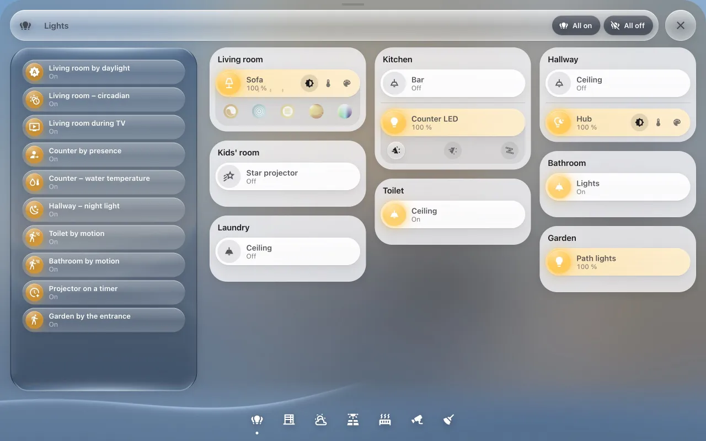
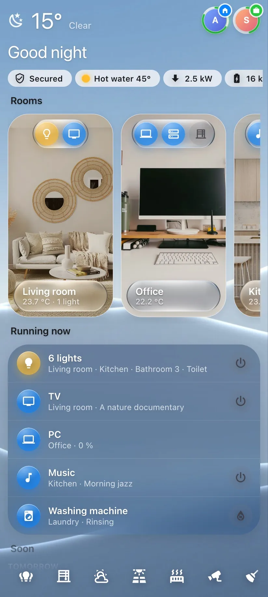
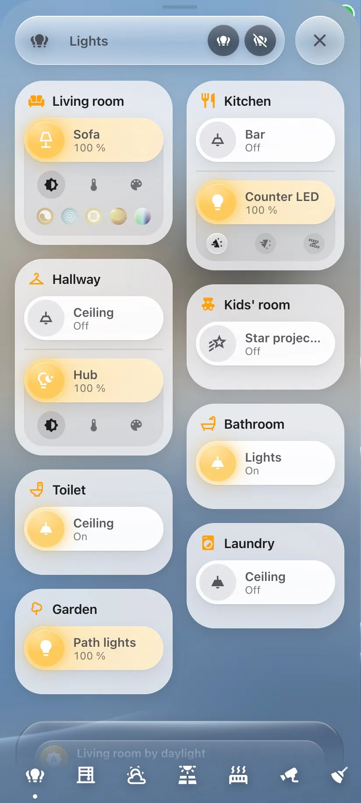

# The demo dashboard

The fastest way to see what Glass Cards and Dashboard Studio can do: the author's own dashboard –
the same layout, photos and pop-ups – running on a made-up home. Alex and Sam, nine rooms, a heat
pump, solar panels with a battery, a washing machine, a robot vacuum, a mop and a lawn mower.

**It doesn't touch your home.** Every card on it runs on invented devices. Switch the lights,
close the blinds, start the vacuum – it all happens in the demo only. Nothing is sent to your
devices and no entities are added to Home Assistant.

## Add it

1. Open Dashboard Studio: add `?glass-studio` to the address of any Home Assistant page, e.g.
   `http://homeassistant.local:8123/lovelace/0?glass-studio`.
2. Click **Demo dashboard** in the top bar.

The dashboard appears in the sidebar as **Glass demo** and opens in Dashboard Studio. Clicking the
button again later just opens it – your changes are kept.

> You need to be an administrator to add a dashboard.

It adds two dashboards: **Glass demo** and, hidden from the sidebar, **Glass demo – pop-ups**
(the pop-up windows live there, as Glass Cards keeps them – see [Layout → Pop-ups](layout.md#pop-ups)).

### Cards the demo uses besides the glass ones

The dashboard itself needs only Glass Cards. Its pop-ups use what the author's do – install them
from HACS for the full demo; without them those parts show an error card:

| Card | By | In the demo |
| --- | --- | --- |
| [Bubble Card](https://github.com/Clooos/Bubble-Card) | [Clooos](https://github.com/Clooos) | Every pop-up – the pop-ups are Bubble Card's |
| [apexcharts-card](https://github.com/RomRider/apexcharts-card) | [RomRider](https://github.com/RomRider) | The energy charts |
| [layout-card](https://github.com/thomasloven/lovelace-layout-card) | [Thomas Lovén](https://github.com/thomasloven) | The full-screen camera pop-ups |
| [solar-arc-card](https://github.com/martinargalas/ha-solar-arc-card) | the author of Glass Cards | The sun and solar production in the energy pop-up |

All the others' work Glass Cards build on: [Credits](credits.md).

## What to try

**On the dashboard**

- The **dock** at the bottom opens the pop-ups: lights, blinds, weather, energy, heating,
  security, cleaning. They slide over the dashboard; ✕ or the back button closes them.
- Tap the light bulbs on the room cards. The photos turn from grey to colour when something is on.
- In **Lights**, pick a scene – the room's lights follow.
- Drag a blind's bar, or the brightness bar of a light.
- **Running now** lists everything that is on (on a phone, under the rooms). Switch one off from there.
- Open it on your phone: the same dashboard rearranges itself for the small screen, and the
  pop-ups have a phone layout of their own.

| Phone | Phone, a pop-up |
| --- | --- |
|  |  |

**In Dashboard Studio**

- Switch the preview between **phone** and **tablet**, and between devices (iPhone, iPad, Galaxy Tab…).
- Click any card in the preview to see its settings on the right.
- Drag a room card to another place – in the preview or in the structure on the left.
- Open the dashboard's **Appearance** and try another look: *liquid*, *frosted*, *light*, *solid*.
- Use the day / night button above the preview to see the night look.
- Click **YAML** (the `{ }` button) to see the configuration change as you edit.

## Use it as a starting point

Every card on the demo is a regular glass card – only `demo: true` on the dashboard makes it
run on the made-up home. To build your own from it:

1. Copy a card (⌘C / Ctrl+C in Dashboard Studio) and paste it into your dashboard (⌘V / Ctrl+V).
2. Replace the entity ids with yours (`light.living_room` → your light) – in the card's settings
   every entity field has a picker.

Or turn the whole demo into yours: open the dashboard's settings, switch **Demo** off and
replace the entities card by card.

## Remove it

**Settings → Dashboards**: delete **Glass demo** and **Glass demo – pop-ups**. That's all there is to it.
