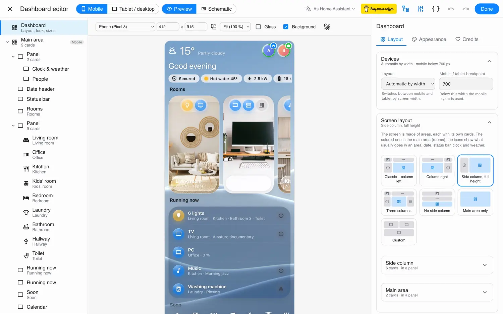

# Dashboard Studio

Dashboard Studio is the editor for glass dashboards: a full-screen window laid out like Home
Assistant's automation editor. [Try it live on the website](https://glass.argalas.org/#studio) –
it runs there on the demo home.


```
┌───────────────┬──────────────────────────────┬────────────────────┐
│  Structure    │  Live preview                │  Settings          │
│               │                              │                    │
│  Header       │   (click a card to pick it,  │  of the picked     │
│  Left column  │    drag it to move it,       │  card or panel     │
│   ├ Weather   │    + to add one)             │                    │
│   └ Calendar  │                              │                    │
│  Main area    │                              │                    │
│   └ Panel     │                              │                    │
└───────────────┴──────────────────────────────┴────────────────────┘
```

## Opening it

| From | How |
| --- | --- |
| A glass dashboard's card editor | Edit the **Glass – dashboard** card. On screens 900 px and wider Dashboard Studio opens on its own; otherwise click **Open the large editor**. |
| Anywhere in Home Assistant | Add `?glass-studio` to the page's address. `?glass-studio=home` opens the dashboard at `/home`. |
| The browser console | `glassStudio()` |

Opened from the card editor, your changes go back to Home Assistant's dialog and its **Save**
saves them. Opened on its own (`?glass-studio`), Dashboard Studio picks the dashboard in its top bar
and saves straight to Home Assistant.

## The top bar

| | |
| --- | --- |
| **Phone / Tablet** | Which layout the preview shows |
| **Preview / Schematic** | The real cards, or a wireframe of the grid where you drag column widths and row heights |
| Language | The studio's own language – the cards keep your profile's |
| Structure / Settings | Show or hide the side panels |
| `{ }` | A wide YAML editor next to the preview |
| ↶ ↷ | Undo and redo (⌘Z / Ctrl+Z, ⇧⌘Z) |
| **Demo dashboard** | Adds the [demo dashboard](demo.md) (standalone studio, administrators) |
| **Save** | Saves. The clock-arrow button next to it undoes the last save. |

## The preview



Above the preview:

- **Device** – real screen sizes: iPhone SE to iPhone 16 Pro Max, Galaxy S24, Pixel 8, Galaxy Tab,
  Nest Hub Max, iPad mini / iPad / iPad Pro, a laptop and Full HD – or a size of your own. Rotate
  turns a tablet to portrait.
- **Scale** – 25 % to 200 %; *Fit* fills the window. 100 % is the device's real size.
- **Glass** – on: the glass is drawn as on the device (slower to redraw). Off: a lighter
  stand-in while you arrange things.
- **Background** – the wallpaper behind the preview, as on the device.
- **Day / night** – follow the dashboard's setting, or force day or night to tune the night look.

## Picking, adding, moving

- **Pick** a card by clicking it in the preview or in the structure. Its settings open on the right.
- **Add**: hover the preview – a **+** appears in every gap. Next to a card it offers *beside*
  (a new row) or *above / below* (a new column). In the structure, **+ Add card into this panel**.
  The card picker searches glass cards, Home Assistant's cards and your HACS cards; **Other card
  (YAML)** takes any card by its YAML.
- **Move**: drag a card in the preview or in the structure. A line shows where it lands; a
  highlighted panel means *into* it. Near the window's edge the view scrolls.
- **Resize**: in a grid, drag a card's corner to span more columns or rows. In the
  **Schematic**, drag the lines between columns and rows. Double-click a line for the default.
- The **⋮** menu of a card (or the keyboard, with a card picked):

| | Keys |
| --- | --- |
| Move up / down | |
| Duplicate | ⌘D / Ctrl+D |
| Copy, Cut, Paste after | ⌘C, ⌘X, ⌘V |
| Paste into (a panel) | |
| Remove | Del |

Copy and paste work between dashboards too – copy in one, open the other, paste.

## Settings of a card

Glass cards have their settings in tabs:

- **Content** – what it shows: entities, names, what a tap does.
- **Appearance** – the material and colour of each part, fonts and icons, and the **night**
  look: switch to *At night* and whatever you change is used only at night.
- **Placement** – size in the grid, **Shown on** (phone / tablet / computer) and when it shows
  (visibility conditions).
- **Credits** – for cards built on other people's work.

Other cards (Home Assistant's, HACS) get Home Assistant's own editor here, or their YAML.

## Pop-ups

With [Bubble Card](https://github.com/Clooos/Bubble-Card) by [Clooos](https://github.com/Clooos) installed, the structure has a
**Pop-ups** section:

- **New pop-up** creates one; open it from a dock button, a room card or a menu with its `#link`.
- Click a pop-up to see it opened over the preview; **Close the pop-up preview** goes back.
- **Pop-ups from another dashboard** keeps them in one place for several dashboards (a tablet
  and a phone dashboard sharing the same windows).
- Pop-ups no button opens are marked *unused*.

No Bubble Card? Use [pages](layout.md#pages-without-pop-ups) instead.

## YAML

The `{ }` button opens a wide YAML editor of the picked item next to the preview. The preview
follows as you type; YAML that doesn't parse is not applied – the last valid version stays.
**Classic editor** (inside Home Assistant's dialog) goes back to Home Assistant's small editor.

## Saving safely

- Before saving, Dashboard Studio checks the dashboard wasn't changed elsewhere since you opened it
  (another browser, another person). If it was, nothing is overwritten and you're told.
- The version before each save is kept **in your browser** – **Undo the last save** puts it back.
- Dashboards kept in YAML files can be shown and explored, not saved.
